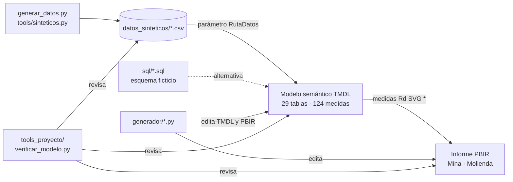

# Power BI como código: informe de operaciones de mina (TMDL + PBIR)

Informe ejecutivo de operaciones de la empresa ficticia **Minera Demo**, escrito como proyecto Power BI en texto (**PBIP con TMDL y PBIR**): dos páginas
(**Mina** y **Molienda**), un modelo semántico de 29 tablas y 124 medidas DAX, tarjetas KPI dibujadas en SVG desde medidas, y un conjunto de generadores
Python y verificadores que mantienen todo coherente sin abrir Power BI Desktop.

> **Aviso: datos 100 % sintéticos de la empresa ficticia Minera Demo.** No hay datos reales, equipos reales, personas, servidores ni marcas de ninguna empresa.
> Los CSV los genera `datos_sinteticos/generar_datos.py`; los logos son ficticios.

## Qué demuestra

- **Power BI en Git**: modelo en TMDL y informe en PBIR, legibles y revisables línea a línea; ids estables; sin binarios ni cachés.
- **DAX no trivial**: ventanas de día de mina (08:00-08:00) y de planta (07:00-07:00) detectadas desde los datos, proyección a 24 h, vista en línea contra día
  cerrado, tablas virtuales con `ADDCOLUMNS` / `TREATAS` / `CONCATENATEX`, plan semanal en dos formatos, cascadas plan a real.
- **Tarjetas KPI en SVG**: una medida arma un SVG (data URI, `ImageUrl`) con barras bullet, semáforos y proyección; una plantilla Python las genera y las reescribe en el TMDL.
- **Power Query parametrizado**: todas las tablas leen CSV a través del parámetro `RutaDatos`; consultas SQL equivalentes contra un esquema ficticio.
- **Generadores idempotentes**: recetas Python que editan TMDL/PBIR por estructura (central de monitoreo, refresco de página, tapas de tooltip, formato de plan).
- **Verificación**: un verificador propio de coherencia modelo-informe-datos y la validación del TMDL con el serializador oficial.

## Alcance

El proyecto cubre las páginas **Mina** y **Molienda**. El modelo incluye, por clausura de dependencias, las tablas, medidas,
relaciones y columnas que esas páginas necesitan (directa o transitivamente por DAX). El modelo es coherente por sí solo
(el verificador lo valida).

| | Slice publicado |
|---|---|
| Páginas | 2 (Mina, Molienda) |
| Visuales | 69 |
| Tablas | 29 (20 importadas desde CSV, 9 calculadas; entre estas, 2 tablas de medidas) |
| Medidas | 124 |
| Relaciones | 10 |

## Diagrama



## Estructura

```text
01-powerbi-tmdl-gestion-minera/
├── pbip/
│   ├── Informe Operaciones Demo.pbip
│   ├── Informe Operaciones Demo.SemanticModel/   # TMDL: tables/, relationships.tmdl, expressions.tmdl, model.tmdl
│   └── Informe Operaciones Demo.Report/          # PBIR: pages/, report.json, StaticResources/ (logos y tema Minera Demo)
├── generador/        # recetas y plantillas Python que editan el PBIP
├── sql/              # esquema ficticio y 5 consultas equivalentes a los CSV
├── datos_sinteticos/ # generar_datos.py y los CSV que lee el modelo
├── tools_proyecto/   # verificar_modelo.py, validar_tmdl.ps1, consultar_dax.ps1
└── docs/             # arquitectura_modelo.md, catalogo_medidas.md, datos_sinteticos.md
```

## Cómo abrirlo

1. En Power BI Desktop activa las vistas previas **Power BI Project (.pbip)**, **Almacenar modelo semántico en formato TMDL** y **Almacenar informes con
   formato de metadatos mejorado (PBIR)**.
2. Clona el repositorio. Los CSV ya están en `datos_sinteticos/`; para regenerarlos: `python datos_sinteticos/generar_datos.py`.
3. Indica dónde están los datos. Power Query necesita una ruta absoluta, así que el parámetro `RutaDatos` viene con el valor relativo `datos_sinteticos\`,
   que no resuelve. Fíjalo con el script (queda solo en tu copia) o desde *Transformar datos > Administrar parámetros*:

   ```text
   python generador/configurar_ruta.py              # fija RutaDatos a la carpeta local
   python generador/configurar_ruta.py --restaurar  # vuelve al valor por defecto antes de subir cambios
   ```

4. Abre `pbip/Informe Operaciones Demo.pbip` y actualiza. El informe abre en «Día actual», que con los datos de ejemplo es el 31 de mayo de 2025
   (hora simulada 14:30).

## Verificaciones

```text
python tools_proyecto/verificar_modelo.py                          # coherencia modelo, DAX, visuales y datos
powershell -File tools_proyecto/validar_tmdl.ps1                   # sintaxis TMDL con el serializador de Power BI Desktop
python generador/validar_esquemas.py                               # PBIR contra los esquemas oficiales (necesita internet)
python tools/verificar_limpio.py --raiz 01-powerbi-tmdl-gestion-minera   # compuerta de seguridad del repositorio
```

`verificar_modelo.py` revisa: JSON válido; cada `ref table` con su archivo y una partición por tabla; relaciones con tablas y columnas existentes y tipos
compatibles; toda referencia `Tabla[Columna]`, `[Medida]` y `'Tabla'` del DAX; ciclos entre medidas; que el DAX no traiga comentarios; que cada partición lea un CSV
cuyas columnas incluyan las del modelo; que los literales con los que el DAX filtra (`Tabla[Col] = "valor"` y las etiquetas de señal) existan en los datos; y que cada
campo de cada visual exista en el modelo, con ids de grupo e interacciones coherentes y recursos presentes.

## Generadores

| Script | Qué hace |
|---|---|
| `tarjetas_svg.py` | plantilla de la tarjeta bullet del día (real, proyección, plan) y reescritura de las 3 medidas en `dax_kpi_tabla.tmdl`; la paleta Minera Demo vive en `PALETA` |
| `caex_plan_formato.py` | reescribe 3 medidas de `Planes_Mina` para leer el plan semanal de CAEX en sus dos formatos |
| `central_monitoreo.py` | segmentadores de fecha en «Día actual», sin estado persistente del usuario, abre en la primera página |
| `refresco_pagina.py` | tabla de pulso, visual invisible y refresco automático de página (con `--origen directquery` para una fuente real) |
| `tapar_hover_svg.py` | botón transparente sobre cada tarjeta SVG para ocultar el tooltip nativo con el texto de la imagen |
| `configurar_ruta.py` | fija el parámetro `RutaDatos` a tu carpeta local |
| `cultura.py` | limpia entidades colgantes del esquema lingüístico |
| `validar_esquemas.py` | valida el PBIR contra los esquemas JSON de Microsoft |
| `escritura_segura.py`, `guardia_desktop.py` | no pisar archivos cambiados por otro proceso; no escribir con Power BI Desktop abierto |
| `abrir_en_primera_pagina.ps1` | lanzador que abre el `.pbip` siempre en la primera página |

Las recetas que editan el PBIP (`tarjetas_svg`, `caex_plan_formato`, `central_monitoreo`, `refresco_pagina`, `tapar_hover_svg`) aceptan `--raiz`, simulan por defecto,
escriben solo con `--aplicar` y son idempotentes. Sobre este repositorio todas informan «sin cambios», porque el PBIP ya está en el estado que ellas producen.

## Qué funciona y qué no se pudo probar

Comprobado al construir el repositorio:

- El TMDL del modelo se deserializa sin errores con el serializador de Power BI Desktop (29 tablas, 124 medidas, 10 relaciones, 1 parámetro).
- El JSON del informe es válido y valida contra los esquemas publicados de PBIR. Las visuales declaran `visualContainer/2.14.0`, esquema que Microsoft aún no publica:
  esas 61 visuales se validaron contra la 2.13.0 (0 errores) y `validar_esquemas.py` las omite avisando.
- `verificar_modelo.py` termina en 0 errores: todas las referencias DAX y todos los campos de los visuales existen, y los datos contienen cada etiqueta y filtro que usa el DAX.
- La lógica de la ventana de planta (inicio, fin, horas efectivas, hora de reinicio, consumo específico) se reprodujo en Python contra los CSV y da valores coherentes.

**No** se pudo probar:

- **Abrir el proyecto en Power BI Desktop y refrescar.** El DAX no se evaluó en un motor y el SVG de las tarjetas no se vio renderizado; los valores esperables salen de la lógica, no de una captura.
- El **refresco automático de página** no se activa con los datos de ejemplo: exige una fuente DirectQuery y `Rd Pulso` es aquí una tabla importada.
- Las consultas de `sql/` no se ejecutaron contra una base de datos (el esquema es ficticio).

## Documentación

- [`docs/arquitectura_modelo.md`](docs/arquitectura_modelo.md): capas, relaciones, día de mina y de planta, patrón SVG, convenciones.
- [`docs/catalogo_medidas.md`](docs/catalogo_medidas.md): las 124 medidas agrupadas por familia.
- [`docs/datos_sinteticos.md`](docs/datos_sinteticos.md): rangos, archivos y situaciones incluidas a propósito.
