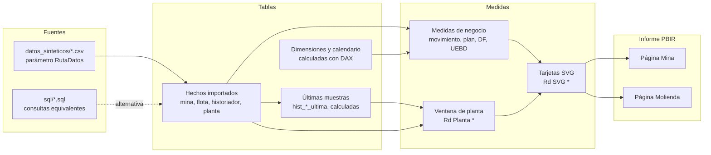
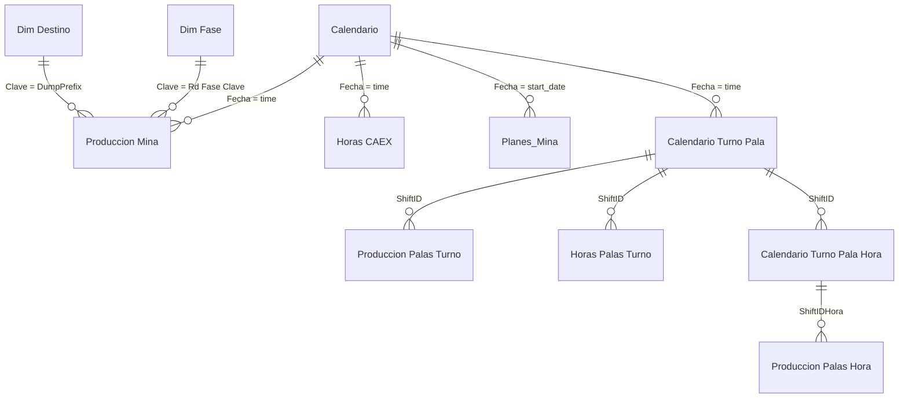

# Arquitectura del modelo

Modelo semántico de una operación minera a rajo abierto de la empresa ficticia **Minera Demo**: 29 tablas, 124 medidas, 10 relaciones
y 2 páginas de informe (Mina y Molienda). Todo el modelo está en formato TMDL y el informe en PBIR, para versionarlo en Git y revisar
los cambios línea a línea. Los datos son 100 % sintéticos.

## Capas



1. **Fuentes.** Cada tabla importada lee un CSV con `Csv.Document(File.Contents(RutaDatos & "archivo.csv"))`. `RutaDatos` es un
   parámetro del modelo (`expressions.tmdl`). Las consultas de `sql/` devuelven las mismas columnas contra un esquema ficticio, para
   reemplazar los CSV por una base de datos sin tocar el modelo.
2. **Tablas.** Hechos de mina y de flota por día, turno y hora; historiador de proceso por muestra (30 min o 1 h); cierres diarios de planta;
   planes. Las dimensiones (`Calendario`, `Dim Destino`, `Dim Fase`) son tablas calculadas. Las tablas `hist_*_ultima` son calculadas:
   la última muestra de cada señal, derivada de los hechos con `GENERATE` + `TOPN`.
3. **Medidas.** Medidas de negocio sencillas (suma de toneladas, cocientes de horas) y, encima, medidas que arman un SVG.
4. **Informe.** Cada tarjeta es una visual de tabla con una medida `ImageUrl`; un botón transparente encima evita el tooltip nativo de la celda.

## Relaciones



Las tablas `Calendario Turno Pala` y `Calendario Turno Pala Hora` son puentes fecha-turno-hora: las tablas de palas no traen una fecha
limpia, así que se relacionan por una clave `fecha + turno (+ hora)` construida como columna calculada en ambos lados.

Las tablas del historiador (`hist_*`), de planta (`planta_*`) y de equipos de planta (`equipos_*`) **no tienen relaciones**: las medidas las
consultan con filtros explícitos (por etiqueta de señal, por punto y por fecha de planta) y no con el contexto de filtro del calendario de
mina. El día de mina (08:00 a 08:00) y el de planta (07:00 a 07:00) son distintos, así que cada familia de medidas resuelve su propio día.

## Tablas por rol

| Rol | Tablas | Origen | Filas aprox. |
|---|---|---|---|
| Calendario y puentes | `Calendario` (calculada), `Calendario Turno Pala`, `Calendario Turno Pala Hora` | DAX / CSV | 92 / 179 / 2.143 |
| Producción de mina | `Produccion Mina` (descargas), `Produccion Palas Hora`, `Produccion Palas Turno` | CSV | 21.430 / 21.430 / 179 |
| Flota | `Horas CAEX`, `Horas Palas Turno` | CSV | 90 / 895 |
| Plan de mina | `Planes_Mina` | CSV | 2.944 |
| Dimensiones | `Dim Destino`, `Dim Fase` | DAX (`DATATABLE`) | 4 / 3 |
| Historiador de proceso | `hist_kpi`, `hist_senales`, `hist_potencia` | CSV | 24.090 / 18.613 / 6.570 |
| Últimas muestras | `hist_kpi_ultima`, `hist_onoff_ultima`, `hist_contador_ultima` | DAX | una fila por señal |
| Cierres y planes de planta | `planta_cierre`, `planta_cierre_ejec`, `planta_plan_spi`, `planta_plan_puntos`, `planta_plan_fase` | CSV | 86 / 86 / 90 / 90 / 270 |
| Equipos de planta | `equipos_df_ue`, `equipos_ciclones` | CSV | 1.246 / 712 |
| Control | `Rd Actualizacion`, `Rd Pulso`, `Rd Planta Parámetros` | CSV / DAX | 1 / 1 / 1 |
| Medidas | `dax_kpi_tabla` (61 medidas), `dax_planta_dia` (12 medidas) | — | — |

## Día de mina y día de planta

- **Día de mina**: 08:00 a 08:00, turno A 08-20 h y turno B 20-08 h. `Rd Día` es el día elegido en el segmentador o, sin selección, el día en curso.
  Las horas transcurridas (`Rd Horas Transcurridas`) salen del último bloque horario con descargas, no del reloj: así la proyección a 24 h
  no se mueve entre actualizaciones. El bloque en curso cuenta media hora.
- **Día de planta**: 07:00 a 07:00. Su inicio y su fin no se suponen: `Rd Planta Inicio` y `Rd Planta Fin` los detectan por la caída del acumulador
  diario de alimentación al SAG (cae a menos de la mitad de un valor sobre 500 t entre dos muestras). `Rd Planta Hora Reset` guarda la hora de esa
  caída. Si hay cierre diario publicado (`planta_cierre`), las medidas lo usan; si no, calculan desde el historiador.
- **Vista en línea vs día cerrado**: `Rd Pl Vivo` es verdadero sin fecha elegida o con el día en curso. Las medidas `Valor_*` devuelven el último dato en
  línea y el cierre del día cuando está cerrado.

El segmentador de fecha usa la columna calculada `Calendario[Día Reporte]`: un rótulo constante «Día actual» para el día en curso y la fecha
`dd-mm-aaaa` para los demás; la selección guardada «Día actual» sigue sola al día nuevo en cada actualización.

## Patrón de las tarjetas SVG

```text
medida DAX  ->  cadena "data:image/svg+xml;utf8,<svg ...>"  ->  visual de tabla (dataCategory: ImageUrl)  ->  imagen
```

- La medida calcula valores (`VAR`), arma el SVG con `&` y devuelve `"data:image/svg+xml;utf8," & SUBSTITUTE(SUBSTITUTE(_svg, "%", "%25"), "#", "%23")`.
  Los colores del semáforo son constantes (verde si alcanza el plan, ámbar si queda hasta 10 % bajo el plan, rojo más abajo, gris sin dato); los de la marca están en `PALETA` de
  `generador/tarjetas_svg.py`.
- Las tarjetas bullet del día (`Rd SVG Movimiento`, `Rd SVG Ampliacion`, `Rd SVG Remanejo`) salen de una plantilla Python; el resto se mantiene a mano.
- Cada tarjeta se pinta en una visual `tableEx` sin columnas visibles; un botón transparente encima (`tapa_<id>`) impide el tooltip nativo con el texto del SVG.

## Convenciones

| Elemento | Convención |
|---|---|
| Medidas de tarjeta y de apoyo | prefijo `Rd` (por ejemplo `Rd SVG Movimiento`, `Rd Planta Inicio`) |
| Carpetas de visualización | `Tarjetas\Mina`, `Tarjetas\Molienda`, `Tarjetas\Fecha`, `Ventana de planta\Base` / `Cierre` |
| Tablas de medidas | `dax_kpi_tabla`, `dax_planta_dia` (columna ficticia oculta) |
| Tablas del historiador | `hist_` + contenido; `_ultima` = una fila por señal |
| Tablas de planta y equipos | `planta_` y `equipos_` + contenido |
| Etiquetas de señal | `AREA.EQUIPO.VARIABLE` en mayúsculas (`SAG.ALIM.TPH`, `EST.BOLAS.01`) |
| Comentarios | descripciones `///` en TMDL; el DAX no lleva comentarios |
| Identificadores | los ids de página y visual son hashes de 20 caracteres; los `lineageTag` son GUID derivados |

## Alcance del modelo

El proyecto cubre las páginas **Mina** y **Molienda**, con todo lo que sus visuales necesitan: las tablas y medidas son la
clausura de dependencias (visual → medida → medidas, columnas y tablas que usa, y las tablas que la propagación de filtros
exige por relaciones).
Las 12 medidas de ventana de planta (`dax_planta_dia`) forman parte del modelo porque las tarjetas de molienda dependen de ellas.

## Límites conocidos

- El modelo no se pudo abrir en Power BI Desktop durante la construcción de este repositorio (ver el README). Lo comprobado: el TMDL se deserializa con
  el serializador oficial, el JSON del informe valida contra los esquemas publicados y `tools_proyecto/verificar_modelo.py` resuelve todas las
  referencias DAX y los campos de los visuales.
- El refresco automático de página requiere una fuente DirectQuery. En el proyecto de ejemplo `Rd Pulso` es una tabla importada desde CSV, así que el
  refresco no se activa; `generador/refresco_pagina.py --origen directquery` deja la partición lista para conectar a una base real.
