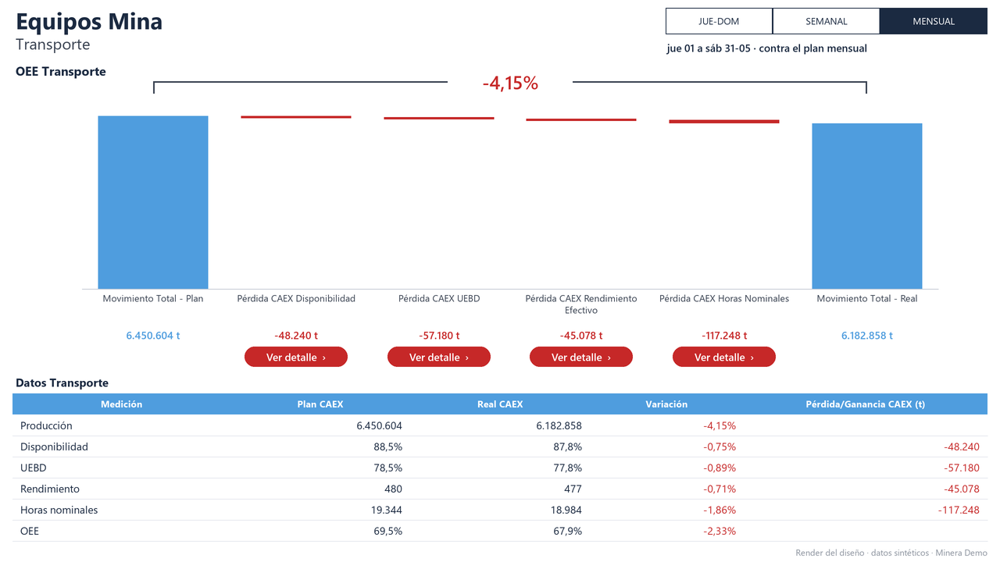
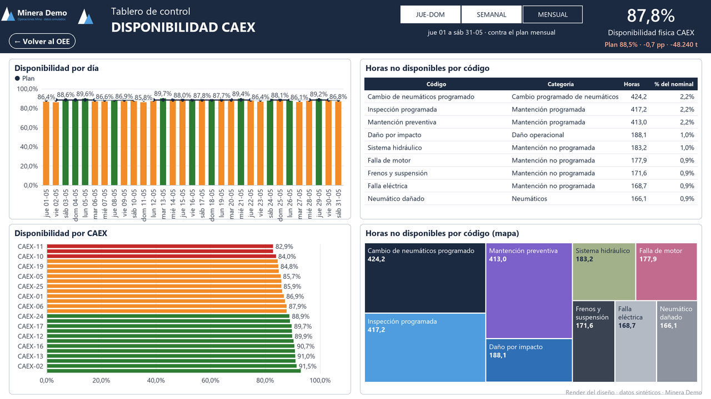
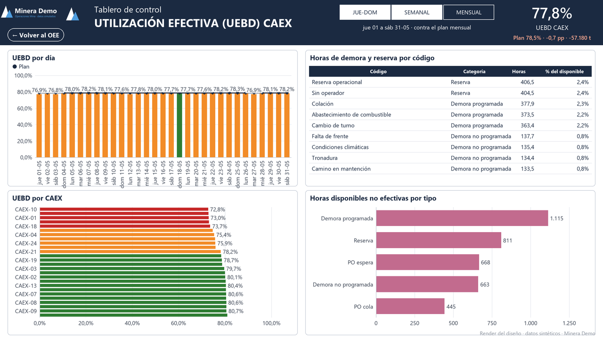
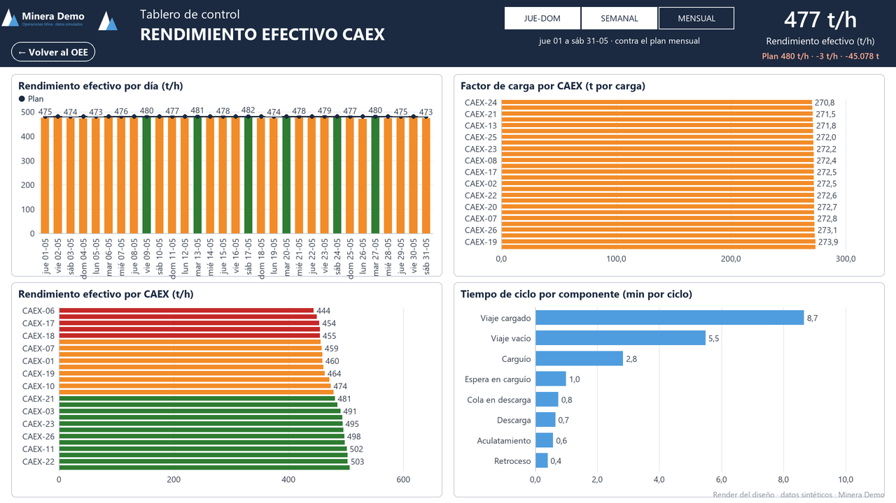
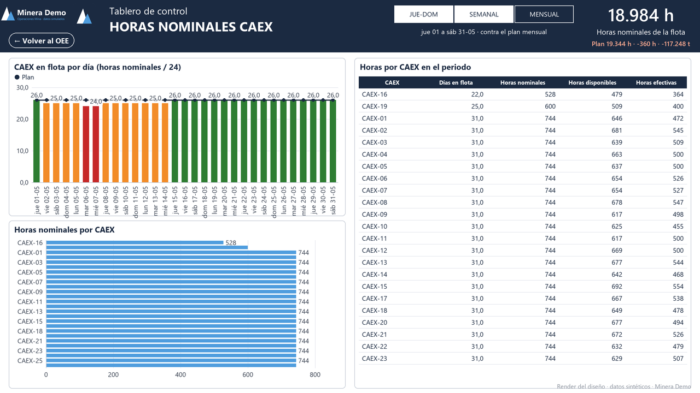
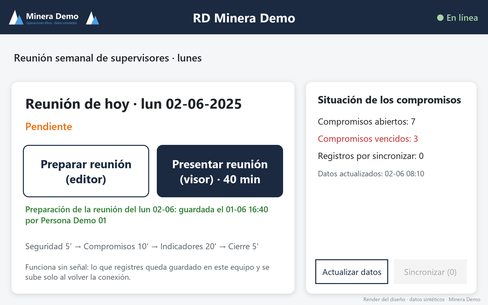
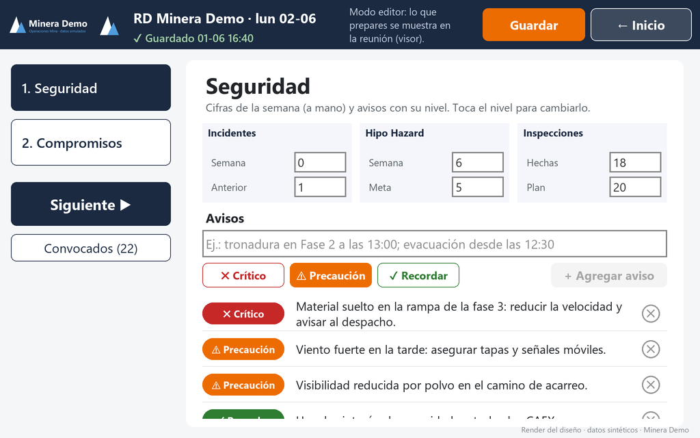
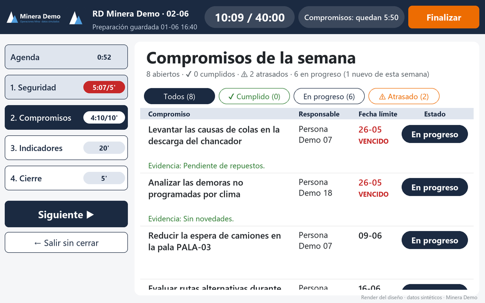
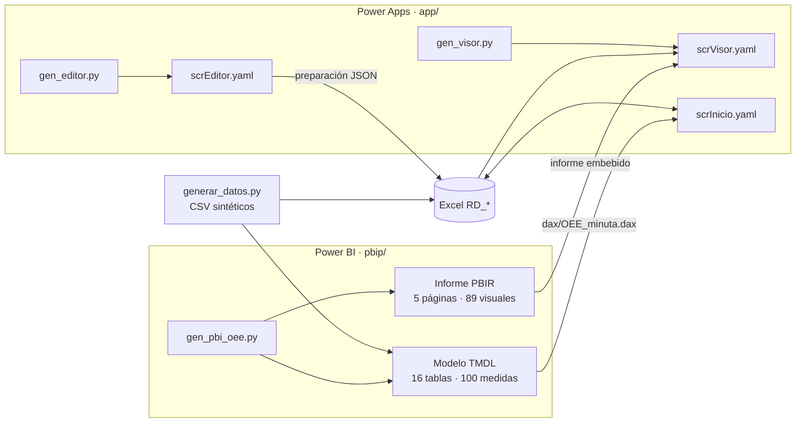

# 02 · OEE de transporte CAEX en Power BI + app de reunión «RD Terreno» en Power Apps

> **Datos 100 % sintéticos de la empresa ficticia «Minera Demo».** Ningún dato, nombre, logo ni sistema corresponde a una
> operación real. Los equipos (`CAEX-01`…`CAEX-26`, `PALA-01`…), las personas (`Persona Demo NN`) y todas las cifras se generan con
> un script reproducible.

## Cómo se ve

> Las imágenes son **renders del diseño**, dibujados con los datos sintéticos del propio proyecto. No son capturas de Power BI Desktop ni de Power Apps Studio.

### Informe de Power BI

<p align="center"><a href="capturas/oee_transporte.png"></a></p>

**OEE Transporte.** La cascada del plan al real con las cuatro pérdidas por palanca (disponibilidad, UEBD, rendimiento efectivo y horas nominales), que suman exactamente
el total (control = 0), con botones «Ver detalle» y la tabla de datos.

<table>
<tr>
<td width="50%"><a href="capturas/disponibilidad.png"></a><br><b>Disponibilidad CAEX.</b> Disponibilidad por día contra el plan, ranking de camiones, horas no disponibles por código y mapa de árbol.</td>
<td width="50%"><a href="capturas/uebd_caex.png"></a><br><b>UEBD CAEX.</b> UEBD por día y por camión con semáforo, horas de demora y reserva por código y horas no efectivas por tipo.</td>
</tr>
<tr>
<td width="50%"><a href="capturas/rendimiento_efectivo.png"></a><br><b>Rendimiento efectivo.</b> Rendimiento (t/h) por día y por camión contra el plan, factor de carga y tiempo de ciclo por componente.</td>
<td width="50%"><a href="capturas/horas_nominales.png"></a><br><b>Horas nominales.</b> Camiones en flota por día contra el plan, horas nominales por camión y tabla de horas por equipo.</td>
</tr>
</table>

### App de Power Apps «RD Terreno»

<table>
<tr>
<td width="33%"><a href="capturas/app_inicio.png"></a><br><b>Inicio.</b> Preparar o presentar la reunión del lunes, estado de la preparación, situación de los compromisos y sincronización.</td>
<td width="33%"><a href="capturas/app_editor.png"></a><br><b>Editor.</b> Cifras de seguridad a mano y avisos con nivel (crítico, precaución, recordar) que luego se presentan en la reunión.</td>
<td width="33%"><a href="capturas/app_visor.png"></a><br><b>Visor.</b> Cronómetro por bloque de la reunión y estado de cada compromiso: semáforo, vencidos, evidencia y filtros.</td>
</tr>
</table>

## Qué hice

**El problema.** Preparar y proyectar la reunión semanal de desempeño de operaciones mina con el OEE de la flota de camiones, y explicar de dónde sale cada tonelada que no se cumplió.

**Cómo lo abordé**

1. **Una cascada que cierra.** Modelé el OEE como una cascada del plan al real que reparte la pérdida en cuatro palancas, y comprobé en Python, sobre los CSV, que
   la suma de las cuatro pérdidas es exactamente la diferencia entre plan y real (control = 0) en los tres periodos.
2. **Dos piezas enlazadas.** El informe de Power BI muestra el resultado; la app de lienzo de Power Apps sirve para llevar la reunión: un **editor** que se prepara
   antes y un **visor** que se proyecta en sala, con funcionamiento sin conexión y minuta por correo.
3. **Ambas se generan con Python.** El proyecto PBIP (TMDL y PBIR) y el código de la app (YAML y Power Fx) salen de generadores; así cambiar una palanca o una
   pantalla es cambiar el generador y regenerar.
4. **Verificación.** Un validador cruza los CSV con el modelo, las relaciones, las referencias de las 100 medidas y de los 89 visuales; los YAML de la app se validan
   sin controles duplicados ni paréntesis desbalanceados.

**El resultado.** Un modelo de 16 tablas y 100 medidas, un informe de 5 páginas y 89 visuales y una app de 3 pantallas, con el validador en 0 problemas.

## Las dos piezas
Un caso completo de **gestión de desempeño de una mina a rajo abierto**, en dos piezas que se enlazan:

1. **Modelo semántico + informe de Power BI («OEE CAEX Demo»)**: el OEE de la flota de camiones (CAEX) con una **cascada del plan al
   real** que separa la pérdida en cuatro palancas (disponibilidad, UEBD, rendimiento efectivo y horas nominales) y un tablero de
   detalle por palanca. Proyecto en formato **PBIP** (modelo en TMDL, informe en PBIR), generado con Python.
2. **App de lienzo de Power Apps («RD Terreno»)** para la reunión semanal de supervisores, con un **editor** (se prepara la
   reunión) y un **visor** (se presenta), funcionamiento sin conexión y minuta por correo. El código fuente (YAML + Power Fx) también
   se genera con Python.



## Qué demuestra
| Habilidad | Dónde verla |
|---|---|
| **Power BI como código** (PBIP, TMDL, PBIR) y generación con Python | `pbip/generador/gen_pbi_oee.py`, `pbir_lib.py`; salida en `pbip/OEE CAEX Demo.*` |
| **DAX avanzado**: periodos relativos a la hora de los datos, cascada de pérdidas que cierra exactamente, semáforo, formato condicional, plan con «último valor conocido» | `Medidas RD.tmdl`, `dax/` |
| **Power Query (M) parametrizado** sobre CSV con tipos y cultura explícitos | parámetro `RutaDatos`, particiones de `tables/*.tmdl` |
| **Modelado dimensional**: dimensiones de tiempo, turno y equipo; hechos por turno, por código y por ciclo; tablas auxiliares | `docs/modelo_datos.md` |
| **Power Apps de lienzo avanzado**: editor y visor, bandeja de salida con `SaveData`, sincronización idempotente, filtros delegables, ventanas de confirmación | `app/pantallas/`, `docs/arquitectura.md` |
| **Generación de YAML/Power Fx con Python** y validación estática de pantallas | `app/herramientas/` |
| **Datos sintéticos reproducibles** con rangos realistas (DF 82-94 %, UEBD 70-85 %, 150-260 kt/día, 15-30 km/h) | `datos_sinteticos/generar_datos.py` |
| **Calidad**: validador del modelo (CSV ↔ TMDL, relaciones, referencias DAX y de visuales) | `pbip/generador/validar_oee.py` |

<details>
<summary><b>Detalles técnicos</b>: estructura, cómo usarlo y cómo abrir el informe y la app</summary>

## Estructura
```
02-oee-caex-y-app-desempeno/
├── datos_sinteticos/
│   ├── generar_datos.py          genera todos los CSV (semilla fija)
│   ├── oee/                      10 CSV del modelo semántico
│   └── app/                      9 CSV con las tablas de la app (esquema de Excel)
├── pbip/
│   ├── generador/                gen_pbi_oee.py · pbir_lib.py · validar_oee.py
│   ├── OEE CAEX Demo.pbip
│   ├── OEE CAEX Demo.SemanticModel/   TMDL: tablas, relaciones, medidas, parámetro RutaDatos
│   └── OEE CAEX Demo.Report/          PBIR: páginas, visuales, tema y logos ficticios
├── app/
│   ├── herramientas/             gen_editor.py · gen_visor.py · yamlgen.py · validadores · crear_excel_demo.py
│   ├── pantallas/                scrInicio.yaml · scrEditor.yaml · scrVisor.yaml
│   ├── formulas/                 App_Formulas.fx · App_OnStart.fx · App_OnError.fx
│   └── LEEME.md                  cómo pegar el código en Power Apps Studio
├── dax/                          consultas DAX (minuta, KPI semanal, planes, validación de la cascada)
├── docs/                         arquitectura · modelo de datos · catálogo de indicadores
└── recursos/                     logos ficticios y tema base de Power BI
```

## Cómo usarlo
Requisitos: Python 3.10+; para abrir el proyecto, Power BI Desktop con las opciones de **proyecto de Power BI (.pbip)** y **formato
TMDL** activadas. El script de datos solo usa la biblioteca estándar y `tools/sinteticos.py` de este repositorio (debe
mantenerse la carpeta `tools/` a la altura de este proyecto).

```
python datos_sinteticos/generar_datos.py          # (re)genera los CSV
python pbip/generador/gen_pbi_oee.py              # (re)genera el PBIP
python pbip/generador/validar_oee.py              # valida modelo, relaciones, DAX y visuales
python app/herramientas/gen_editor.py             # (re)genera pantallas/scrEditor.yaml
python app/herramientas/gen_visor.py              # (re)genera pantallas/scrVisor.yaml
python app/herramientas/validar_pantallas.py
```

### Abrir el informe de Power BI
1. Abrir `pbip/OEE CAEX Demo.pbip` en Power BI Desktop.
2. **Transformar datos › Administrar parámetros** y fijar `RutaDatos` con la ruta completa de `datos_sinteticos\oee\`, **terminada en
   barra invertida** (por ejemplo, `<ruta donde clonaste el repositorio>\02-oee-caex-y-app-desempeno\datos_sinteticos\oee\`). El valor por
   defecto es un marcador (`<CARPETA_DEL_REPO>`), también editable en `definition/expressions.tmdl`.
3. **Actualizar**. El periodo por defecto es SEMANAL; los tres (JUE-DOM, SEMANAL, MENSUAL) se calculan hasta «ayer» respecto de la
   marca de `Dim_Actualizacion` (2025-06-01 09:30).

### Usar la app en Power Apps
Ver `app/LEEME.md`: pegar el YAML de cada pantalla con «Ver código», pegar las fórmulas, crear las tablas de Excel desde
`python app/herramientas/crear_excel_demo.py` (requiere `openpyxl`) y conectar Excel, Outlook y Office 365 Users. Los identificadores de
Power BI de la página «Indicadores» (`gen_visor.py`) son marcadores.

</details>

## Qué se probó y qué no
- **Probado**: los scripts de Python corren y son reproducibles; los CSV cumplen los rangos pedidos (movimiento diario de la flota 186-210 kt,
  DF ~88 %, UEBD ~78 %); `validar_oee.py` da 0 problemas (CSV ↔ TMDL, 11 relaciones, referencias de las 100 medidas y de los 89 visuales);
  las fórmulas de la cascada se reprodujeron en Python sobre los CSV y cierran (control = 0) en los tres periodos; los YAML de la app son
  válidos, sin controles duplicados ni paréntesis desbalanceados.
- **No probado**: la apertura y actualización del PBIP en Power BI Desktop (puede requerir ajustes menores en el TMDL que Desktop no
  acepte), la ejecución de las consultas de `dax/` contra el modelo, y la app en Power Apps Studio (pegado del YAML, conectores y flujos
  `RD-OEE-Minuta` y `RDSubirEvidencia`, que aquí solo se describen).
- Los logos son ficticios (`recursos/`); el tema base de Power BI (`BaseTheme_CY26SU07.json`) es el que distribuye Microsoft.
