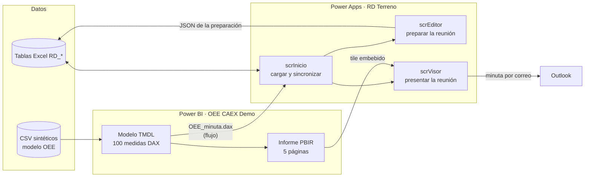

# Arquitectura: Editor, Visor y modelo OEE

El proyecto tiene dos piezas que se enlazan en una pantalla: una **app de lienzo de Power Apps** («RD Terreno») para la reunión
semanal de desempeño y un **modelo semántico + informe de Power BI** («OEE CAEX Demo») con el OEE de la flota de transporte.

## Editor y visor
| Pieza | Rol | Contenido |
|---|---|---|
| `scrInicio` | Puerta de entrada | «Actualizar datos» lee las tablas Excel a colecciones locales; «Sincronizar (n)» sube lo pendiente; estado de conexión. |
| `scrEditor` | **Se prepara** (antes de la reunión) | Seguridad (indicadores a mano y avisos con nivel), Compromisos (estado de los de la semana pasada, evidencia, compromisos nuevos) y Convocados. |
| `scrVisor` | **Se presenta** (en la reunión) | Agenda con cronómetro por bloque, Seguridad, Compromisos (solo lectura), Indicadores (informe OEE embebido), Cierre, asistencia, visor de evidencias y minuta. |

La preparación se guarda como **un JSON por fecha de reunión** (tabla `RD_Preparacion`, clave = fecha): `seg` (resumen), `avi`
(avisos con nivel), `ind` (indicadores de seguridad), `est` (estado de cada compromiso), `des` (destacados) y `nue` (compromisos
nuevos). El visor lee exactamente esa fila, de modo que lo que se prepara es lo que se presenta.

## Funcionamiento sin conexión
- Todo lo leído queda en colecciones y en `SaveData` del equipo; si no hay señal se trabaja con la última carga.
- Lo que se genera (sesión, revisiones, compromisos nuevos, evidencias, asistencia, minuta, preparación) va a una **bandeja de
  salida** (`colOut*`) también persistida con `SaveData`. «Sincronizar» la vacía hacia Excel.
- La subida es **idempotente**: cada fila lleva un `IdLocal` y no se vuelve a crear si ya existe; el `ID` de los compromisos
  nuevos se numera al sincronizar (el máximo del Excel + 1, 2, …) con un resguardo contra números repetidos.
- Las lecturas usan `Refresh` y filtros delegables con un solo `=` para que Excel filtre la tabla completa.

## Código generado
`app/herramientas/gen_editor.py` y `gen_visor.py` escriben el YAML de las pantallas con las ayudas de `yamlgen.py` (contenedores,
etiquetas, botones, galerías, confirmaciones). Las fórmulas largas viven como cadenas de Python, de modo que se reutilizan entre
pantallas (por ejemplo, agregar/editar/eliminar compromisos nuevos en el editor y en el visor). `validar_pantallas.py` revisa
nombres de control duplicados y paréntesis desbalanceados; `diff_pantalla.py` compara una pantalla copiada de Studio con el YAML.

`pbip/generador/gen_pbi_oee.py` hace lo mismo para Power BI: escribe el TMDL del modelo (tablas desde CSV, relaciones, medidas) y el
PBIR del informe (páginas, visuales, formato condicional) con `pbir_lib.py`. Los identificadores salen de un hash del nombre:
regenerar no cambia los `lineageTag` ni los ids de páginas y visuales.

## Integración
- **Informe en la app**: la página «Indicadores» del visor usa el control de Power BI con la URL de inserción del informe y el id de
  la página «OEE Transporte». Cada botón «Ver detalle» navega a su página de detalle dentro del mismo informe.
- **Minuta**: al actualizar datos, un flujo ejecuta `dax/OEE_minuta.dax` y devuelve una fila por periodo; la minuta detalla solo
  las palancas que quedaron bajo el plan, con la misma regla que el botón rojo del informe.
- **Evidencias**: un flujo guarda la foto o el archivo en una biblioteca de documentos y devuelve su URL.
