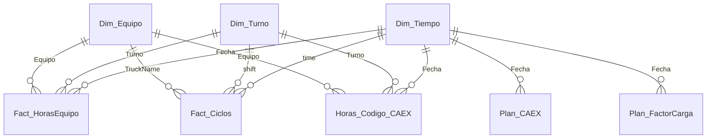

# Modelo de datos

Todos los datos son sintéticos y se generan con `python datos_sinteticos/generar_datos.py` (semilla fija): 90 días desde el
lunes 2025-03-03, 26 CAEX (`CAEX-01`…`CAEX-26`), 4 palas (`PALA-01`…`PALA-04`), turnos A (08:00-20:00) y B (20:00-08:00) y personas
ficticias (`Persona Demo NN`, correo `@minera-demo.example`).

## Modelo semántico `OEE CAEX Demo` (carpeta `datos_sinteticos/oee/`)
Unidades: horas (h), toneladas (t) y rendimiento en t/h. El movimiento diario de la flota (186-210 kt, es decir, miles de t) se
muestra en t completas en las medidas y gráficos. DF ~88 % y UEBD ~78 % de promedio.

| Tabla | Grano | Filas aprox. | Uso |
|---|---|---|---|
| `Fact_HorasEquipo` | CAEX × turno × día (12 h nominales por turno) | 4.596 | Horas nominales, disponibles, efectivas, demoras, reserva, PO espera/cola, mantención y movimiento (t). |
| `Horas_Codigo_CAEX` | CAEX × turno × día × código (últimos 45 días) | 18.300 | Porqué de la disponibilidad (mantención) y de la UEBD (demoras y reserva). |
| `Fact_Ciclos` | Muestra de 2 ciclos por CAEX y turno | 9.200 | Payload y tiempos de ciclo en segundos (viaje vacío, espera, aculatamiento, carguío, viaje cargado, cola, descarga, retroceso). |
| `Plan_CAEX` | Día | 88 | Plan semanal día a día (horas nominales, disponibles, efectivas y toneladas). Dos días sin plan a propósito. |
| `Planes_Mina` | Día × ítem | 360 | Plan mensual: `Horas Nominales/Disponibles/Efectivas CAEX` y `Total Toneladas CAEX`. |
| `Plan_FactorCarga` | Día | 85 | Plan del factor de carga (t por carga); cinco días sin plan. |
| `Dim_Tiempo`, `Dim_Turno`, `Dim_Equipo`, `Dim_Actualizacion` | | | Calendario con el día operacional (cambia a las 08:00), turnos, equipos y marca de la última actualización. |
| `Periodo RD`, `Cascada OEE`, `Datos OEE`, `Tipos UEBD`, `Componentes ciclo` | | | Tablas calculadas (`DATATABLE`) para segmentador, cascada, tabla y ordenamiento de gráficos. |
| `Medidas RD` | | | Solo aloja las 99 medidas DAX, en carpetas: Periodo, OEE\Real, OEE\Plan, OEE, OEE\Gráfico, OEE\Tabla, Detalle…. |

**Relación de la hora del modelo con los periodos.** `Dim_Actualizacion[Marca]` (2025-06-01 09:30) hace de «ahora»: el último día
es ayer (2025-05-31) y de ahí salen SEMANAL, JUE-DOM y MENSUAL. Para ver otro corte basta cambiar esa fila y regenerar.

**Origen de datos.** Cada partición M lee `RutaDatos & "<Tabla>.csv"` con `Csv.Document` y tipos con cultura `en-US`. `RutaDatos`
es un parámetro del modelo (`definition/expressions.tmdl`); ver el README del proyecto para fijarlo.

## Tablas de la app (carpeta `datos_sinteticos/app/`)
Cada una es una tabla de Excel con el nombre del origen de datos de la app. Fechas como texto `aaaa-mm-dd` (y `aaaa-mm-dd hh:mm`),
`Abierto` y `Activo` como `Sí`/`No`.

| Tabla | Clave / columnas principales |
|---|---|
| `RD_Compromisos` | `ID`, `Titulo`, `ResponsableNombre`, `FechaLimite`, `Estado` (En progreso, Cumplido, Atrasado), `Abierto`, `EvidenciaUrl`, `IdLocal`. |
| `RD_RevisionCompromisos` | Una fila por revisión: `CompromisoId`, `EstadoAnterior`, `EstadoNuevo`, `Comentario`, `Clave`. |
| `RD_Sesiones` | Una fila por reunión cerrada: horas, minutos, asistentes, `TemaSeguridad`, `TiemposBloques` (JSON). |
| `RD_Participantes` | Convocados: `Nombre`, `Correo` (identificador), `Cargo`, `Activo`, `Area`. |
| `RD_Asistencia` | Una fila por reunión; `Json` con la lista de convocados e invitados y su asistencia. |
| `RD_Preparacion` | Una fila por fecha de reunión (`Clave`); `Json` con la preparación del editor. |
| `RD_PlanSemanal` | Meteorología, actividades, tronaduras, posicionamiento y riesgos por semana. |
| `RD_Destacados` | Highlights, lowlights y temas por reunión (la sección ya no se muestra, la tabla se conserva). |
| `RD_KPI` | JSON semanal con los 13 indicadores del catálogo (ver `catalogo_indicadores.md`). |

`app/herramientas/crear_excel_demo.py` arma los `.xlsx` desde estos CSV (columnas de texto con formato `@`, tabla de Excel con el
nombre del origen de datos).
