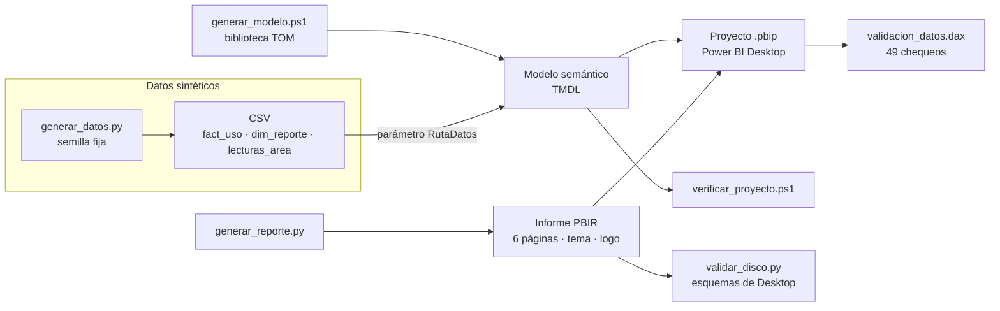
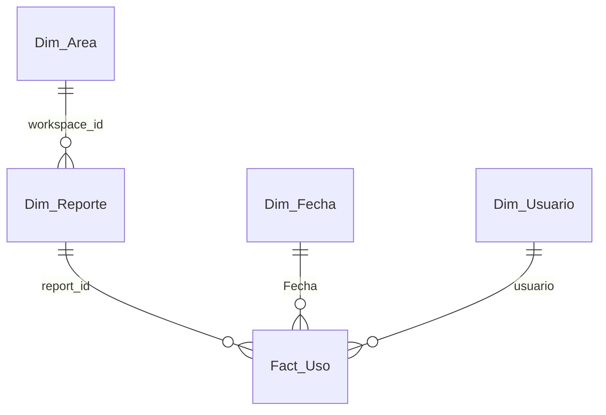

# Gobernanza de uso de reportes Power BI, construida como código


> **Datos 100 % sintéticos de la empresa ficticia Minera Demo.** Workspaces, reportes, usuarios e identificadores son
> inventados y se generan con un script reproducible. Nada de lo publicado proviene de un sistema real.

Informe de Power BI que responde una pregunta de gobernanza: **quién abre qué informe y cuánto, para detectar los
informes sin uso** (candidatos a revisar o retirar), los que solo registran aperturas sin vistas de página (posible
acceso automatizado) y las áreas cuya extracción de datos quedó atrasada. El modelo semántico (TMDL) y el informe
(PBIR) no se dibujan en Desktop: **salen de código**, así que se pueden regenerar, revisar en un diff y verificar
sin abrir la herramienta.

## Qué demuestra

- **Power BI como código**: modelo en TMDL generado con la biblioteca TOM de Desktop (`generar_modelo.ps1`) e informe
  en PBIR de 6 páginas y 59 visuales generado con Python (`generar_reporte.py`), con tema y logo como recursos.
- **Modelado y DAX**: esquema en estrella (hecho a grano día x reporte x usuario), 22 medidas organizadas por carpeta con
  descripción, guardas contra combinaciones inexistentes, estado de reporte (en uso / solo aperturas / sin uso) y un eje
  dinámico (`TREATAS` + `KEEPFILTERS`) que cambia de áreas a reportes según la segmentación.
- **Power Query (M) robusto**: lectura de CSV con un parámetro `RutaDatos`, esquema fijo, fechas estrictas con mensaje
  de error claro, claves normalizadas, nombres únicos de reporte y exclusión de cuentas de mantenimiento.
- **Compuertas de calidad**: verificación estructural (`verificar_proyecto.ps1`), validación de cada JSON contra los
  esquemas oficiales (`validar_disco.py`) y 49 chequeos de datos en DAX (`validacion_datos.dax`).
- **Datos sintéticos reproducibles** con casos de borde incluidos a propósito.

## Cómo se construye



## Modelo



`_Medidas` guarda las 22 medidas y `Eje_Detalle` (tabla calculada, sin relaciones) alimenta el gráfico dinámico de la
página Detalle. Todas las relaciones son varios a uno y filtran en un solo sentido.

## Páginas del informe

| Página | Para qué sirve |
|---|---|
| Resumen | Total de reportes y su estado (en uso, solo aperturas, sin uso), tendencias y tabla por reporte |
| Vistas | Matrices reporte x día (últimos 28 días) con mapa de calor, de vistas y de usuarios únicos |
| Vistas por semana | Lo mismo por semana (lunes a domingo, con las semanas parciales marcadas) |
| Sin uso | Reportes sin vistas de página: candidatos a revisar, con su última actividad |
| Detalle | Un reporte: uso diario, usuarios, comparación interna/externa y ranking de aperturas |
| Calidad | Profundidad del histórico, cobertura de la extracción por área, nombres repetidos y accesos sin vistas |

Todas las páginas llevan el aviso visible de datos sintéticos y el logo ficticio de Minera Demo.

## Estructura

```
03-governance-bi-as-code/
├── Gobernanza_uso_reportes.pbip              punto de entrada para Power BI Desktop
├── Gobernanza_uso_reportes.SemanticModel/    modelo TMDL (generado)
├── Gobernanza_uso_reportes.Report/           informe PBIR, tema y logo (generado)
├── datos_sinteticos/
│   ├── generar_datos.py                      genera los CSV (usa ../tools/sinteticos.py)
│   ├── esperados.json                        cifras que debe dar el modelo
│   └── csv/                                  fact_uso, dim_reporte, lecturas_area
├── desarrollo/
│   ├── generar_modelo.ps1                    TMDL + medidas (fuente de verdad de las 22 medidas)
│   ├── generar_reporte.py                    PBIR: páginas, visuales, tema
│   ├── verificar_proyecto.ps1                verificación estructural y de campos
│   ├── validar_disco.py                      validación de JSON contra esquemas
│   ├── extraer_esquemas.py                   saca los esquemas de la instalación de Desktop
│   ├── validacion_datos.dax                  49 chequeos para la Vista de consultas DAX
│   ├── medidas_vista_TMDL.tmdl               las medidas, listas para pegar en la Vista TMDL
│   └── config_datos.json                     cuentas excluidas del conteo
└── docs/GUIA.md                              guía de trabajo
```

## Cómo abrirlo

Requisitos: Windows, Power BI Desktop, Python 3.10+ (`pip install jsonschema` es opcional).

```powershell
# 1. Datos (ya vienen en datos_sinteticos/csv; esto los reproduce)
python datos_sinteticos/generar_datos.py

# 2. Apuntar el modelo a los CSV de este clon (desde la carpeta desarrollo/)
powershell -NoProfile -ExecutionPolicy Bypass -File generar_modelo.ps1 -Local

# 3. Abrir Gobernanza_uso_reportes.pbip en Power BI Desktop y Actualizar
```

El valor versionado de `RutaDatos` es el marcador `RUTA_DEL_CLON`: cada persona fija su ruta con `-Local` (no subir ese
cambio) o en Desktop, en Transformar datos > Administrar parámetros. Detalles en [docs/GUIA.md](docs/GUIA.md).

Para verificar sin abrir Desktop:

```powershell
powershell -NoProfile -ExecutionPolicy Bypass -File desarrollo\verificar_proyecto.ps1
```

Para regenerar el informe: `python desarrollo/generar_reporte.py`. Con `python desarrollo/extraer_esquemas.py`
antes, valida cada JSON contra los esquemas de la instalación local.

## Datos sintéticos y casos incluidos

90 días (2025-03-03 a 2025-05-31), 4 áreas, 24 reportes, 20 usuarios (`persona.demoNN` y `ext.demoNN`, con correo
`@minera-demo.example`) y una cuenta de mantenimiento que el modelo excluye. El conjunto trae a propósito: reportes
sin uso, reportes que solo registran aperturas, uno abandonado, dos reportes con el mismo nombre en áreas distintas,
una cuenta automatizada y un área cuya extracción se detuvo antes del final.

## Estado de la verificación

- **Verificado**: el TMDL se deserializa con la biblioteca TOM de Desktop (7 tablas, 4 relaciones, 22 medidas); todos los
  campos que usan los visuales existen en el modelo; los 69 JSON del informe validan contra los esquemas de Desktop; el
  repositorio pasa el escáner de seguridad. Las cifras esperadas de `validacion_datos.dax` se recalcularon por separado
  a partir de los CSV.
- **No probado**: la carga de los CSV por las consultas M y los 49 chequeos DAX dentro de Desktop; tampoco la
  apariencia final del informe ni la visualización del logo. Esos pasos requieren abrir Desktop.
- **Limitaciones de diseño**: los generadores reemplazan por completo `definition/`; lo guardado desde Desktop no se
  conserva si se regenera. El servicio de métricas de uso de Power BI guarda unos 30 días, por lo que un histórico largo
  necesita una extracción periódica que aquí solo se describe (ver la guía).
