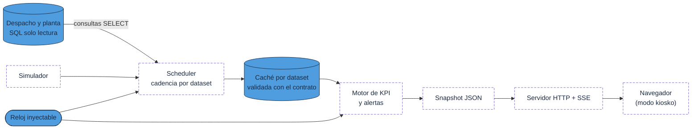

# Despacho Mina en Tiempo Real

Núcleo y arquitectura de un dashboard web local para la sala de despacho de una mina a rajo abierto:
turnos y día operacional, contratos de datos, consultas SQL de solo lectura con doble barrera, datos
sintéticos reproducibles y un diseño completo (scheduler → motor → snapshot → SSE → navegador).

> **Datos 100 % sintéticos de la empresa ficticia «Minera Demo».** No hay datos, nombres, servidores,
> credenciales ni coordenadas reales; las posiciones GPS son ficticias y no apuntan a ninguna faena.

## Estado real del proyecto

Este repositorio es **«núcleo + arquitectura»**. Lo que figura como hoja de ruta está diseñado en
`docs/` pero **no está implementado**.

| Componente | Estado |
|---|---|
| Tiempo operacional: turnos A/B, día operacional, zona horaria, reloj inyectable | Implementado, con tests |
| Configuración `.env` + TOML con enmascarado de secretos | Implementado, con tests |
| Contratos de datos (15 datasets), validación y normalización | Implementado, con tests |
| Barrera de solo lectura SQL y enlace de parámetros | Implementado, con tests |
| 8 consultas SQL de referencia sobre un esquema ficticio | Incluido; validadas contra el contrato |
| Generador de datos sintéticos (CSV) y snapshot de ejemplo | Implementado, con tests |
| Programador por cadencias, motor de KPI, alertas | Hoja de ruta |
| Servidor HTTP + SSE, persistencia SQLite | Hoja de ruta |
| Simulador y frontend (HTML/CSS/JS, gráficos SVG propios) | Hoja de ruta |

## Qué habilidades demuestra

- **Diseño de arquitectura** con decisiones justificadas y alternativas descartadas (`docs/ARQUITECTURA.md`, `docs/DECISIONES.md`).
- **Python con solo biblioteca estándar**: `tomllib`, `zoneinfo`, `dataclasses`, `unittest`; sin dependencias externas.
- **Modelado de tiempo operacional**: turnos de 12 h, día operacional desplazado, reloj inyectable para tests deterministas.
- **Seguridad de datos**: validador de solo lectura sobre el texto SQL (comentarios, cadenas e identificadores no engañan al analizador),
  parámetros nunca concatenados, valores por defecto seguros y checklist de ciberseguridad.
- **SQL**: consultas con CTE, agregación por hora, pivotes, ventanas (`ROW_NUMBER`) y conversión de zona horaria por parámetro.
- **Contratos y tests**: cada consulta se valida contra el contrato de su dataset (parámetros, orden y columnas).
- **Datos sintéticos reproducibles** con semilla fija y verificación de rangos operacionales.

## Arquitectura



Azul: implementado en este repositorio. Línea punteada: **previsto** (hoja de ruta), incluido el frontend.

Estados de datos que mostrará el encabezado: **EN VIVO**, **ATRASADO**, **SIN CONEXIÓN** y **DEMO**
(reglas en `docs/ARQUITECTURA.md`). Si la fuente real funcionó alguna vez, una caída nunca vuelve al simulador en silencio.

## Estructura

```
04-despacho-tiempo-real/
  backend/despacho/        tiempo.py, config.py, contratos.py, datos/ (base, solo_lectura, consultas)
  config/                  dashboard.toml, mapa.toml, plan_horario.toml, alertas.toml
  sql/                     esquema_demo.sql y consultas/ (equipos, ciclos, gps, velocidad_hora, chancado_hora,
                           horas_equipo, plan_caex, plan_indicadores)
  datos_sinteticos/        generar_datos.py y los CSV que produce
  docs/                    ARQUITECTURA, CONTRATOS, DECISIONES, CHECKLIST_CIBERSEGURIDAD, snapshot_ejemplo.json
  frontend/assets/         logos ficticios de Minera Demo (el frontend no está implementado)
  tests/                   unittest
  env.ejemplo              plantilla de variables de entorno (solo marcadores)
```

## Cómo ejecutar

Requiere Python 3.11 o superior; no hay nada que instalar.

```bash
# tests (desde esta carpeta)
PYTHONPATH=backend python -m unittest discover -s tests -t . -v
```

En PowerShell: `$env:PYTHONPATH="backend"; python -m unittest discover -s tests -t . -v`.

Regenerar los datos sintéticos (CSV en `datos_sinteticos/` y `docs/snapshot_ejemplo.json`):

```bash
python datos_sinteticos/generar_datos.py
```

El generador importa `tools/sinteticos.py` de la raíz del repositorio. Un test verifica que los archivos
publicados coinciden con la salida actual del generador.

Ejemplo de uso del núcleo:

```python
import datetime as dt
from despacho import tiempo
from despacho.datos import base, consultas
from despacho.datos.solo_lectura import es_solo_lectura

tiempo.configurar_zona("UTC")                       # o un nombre IANA, con respaldo de desfase fijo
ahora = tiempo.a_local(dt.datetime(2025, 5, 31, 15, 3))
print(tiempo.turno_de(ahora).nombre)                # Turno A (hora de turno 8, día operacional 2025-05-31)

params = base.parametros_consulta(ahora)            # parámetros calculados con el reloj
sql = consultas.cargar_consulta("gps")              # lee sql/consultas/gps.sql y valida solo lectura
sql_odbc, valores = consultas.a_posicional(sql, params)   # @Nombre -> ? y valores en orden

print(es_solo_lectura("DELETE FROM equipos"))       # False
```

No hay conexión a ninguna base de datos en este repositorio: las consultas están escritas contra el esquema
ficticio de `sql/esquema_demo.sql` (bases `despacho_demo` y `planta_demo`) y no se han ejecutado contra un motor SQL.

## Datos sintéticos

Periodo de 90 días desde 2025-03-03; el instante del snapshot es el último día (15:03). Semilla fija:
dos ejecuciones producen archivos idénticos.

| Archivo | Contenido | Rango |
|---|---|---|
| `ciclos_hora_pala_camion.csv` | Ciclos por hora, carguío y camión (últimos 7 días) | 25 CAEX, 4 palas y 2 cargadores |
| `velocidad_caex_hora.csv` | Velocidad media por hora y camión (últimos 7 días) | 15–30 km/h |
| `chancado_hora.csv` | Alimentación a chancado y plan horario (90 días) | 3.200–4.800 t/h |
| `granulometria_hora.csv` | Granulometría en 3 fracciones (90 días) | ~60/20/20 % |
| `plan_gaviota_hora.csv` | Plan vs real por hora, curva gaviota (90 días) | movimiento 150–260 kt/día |
| `equipos.csv`, `gps.csv` | Catálogo (`CAEX-01..26`, `PALA-01..04`, …) y últimas posiciones | contratos `equipos` y `gps` |
| `docs/snapshot_ejemplo.json` | Snapshot completo del dashboard | DF 82–94 %, UEBD 70–85 % |

## Configuración

- `env.ejemplo`: variables de entorno (modo de datos, servidor web, bases `servidor-demo`, zona horaria). Copiar como `.env`.
- `config/dashboard.toml`: refrescos, frescura, ventanas, proyección y planes por defecto (valores de ejemplo).
- `config/plan_horario.toml`: perfil horario del plan (curva «gaviota»).
- `config/mapa.toml`: calibración GPS → pantalla y rutas; las coordenadas son ficticias.
- `config/alertas.toml`: reglas de alerta (el motor que las evalúa es hoja de ruta).

## Hoja de ruta

1. Scheduler con hilos, caché por dataset y control de solapes.
2. Motor de KPI (proyección de cierre, ciclos por ruta, flota) y motor de alertas.
3. Servidor HTTP con SSE y persistencia SQLite.
4. Simulador sobre el contrato de datos.
5. Frontend sin build (HTML, CSS, módulos ES, gráficos en SVG propio).

## Alcance

Proyecto de portafolio con datos ficticios. Sin garantía de uso operacional.
