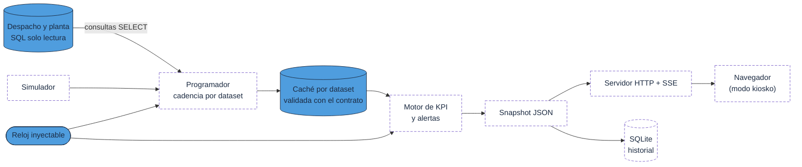

# Arquitectura

## Objetivo

Un dashboard web local para la sala de despacho de una mina a rajo abierto: se refresca cada pocos
segundos, muestra movimiento, ciclos, chancado y flota contra el plan, levanta alertas y propone
acciones. Debe funcionar hoy con datos simulados y pasar a datos reales completando credenciales,
sin tocar código.

## Estado del proyecto

Este repositorio contiene el **núcleo y la arquitectura**. El servidor, el simulador y el frontend
están diseñados (ver contratos) pero **no implementados**.

| Componente | Estado | Dónde |
|---|---|---|
| Tiempo operacional: turnos, día operacional, zona horaria, reloj inyectable | Implementado, con tests | `backend/despacho/tiempo.py` |
| Configuración: `.env` + TOML, enmascarado de secretos | Implementado, con tests | `backend/despacho/config.py`, `config/` |
| Contratos de datos: 15 datasets, validación y normalización | Implementado, con tests | `backend/despacho/contratos.py` |
| Interfaz de fuentes, caché por dataset, parámetros de consulta | Implementado, con tests | `backend/despacho/datos/base.py` |
| Barrera de solo lectura SQL y enlace de parámetros | Implementado, con tests | `backend/despacho/datos/solo_lectura.py`, `consultas.py` |
| Consultas de referencia (8) y esquema ficticio | Incluido, validado contra el contrato | `sql/` |
| Generador de datos sintéticos y snapshot de ejemplo | Implementado, con tests | `datos_sinteticos/`, `docs/snapshot_ejemplo.json` |
| Programador (scheduler), motor de KPI, alertas | Hoja de ruta | — |
| Servidor HTTP + SSE, persistencia SQLite | Hoja de ruta | — |
| Simulador y frontend (HTML/CSS/JS, SVG propio) | Hoja de ruta | — |

## Decisiones de arquitectura

| Decisión | Alternativas descartadas | Por qué | Estado |
|---|---|---|---|
| Backend en Python **solo con biblioteca estándar** (`http.server`, `sqlite3`, `tomllib`, `zoneinfo`, `threading`) | FastAPI, Flask, Node | El equipo de la sala puede estar sin internet y sin permisos de instalación. Menos dependencias = menos aprobaciones de seguridad y menos fallas. | Núcleo sin dependencias |
| Empuje al navegador con **Server-Sent Events** | WebSockets, polling | SSE va sobre HTTP simple, `EventSource` se reconecta solo y basta para un flujo unidireccional cada 10 s. No requiere librerías. | Previsto |
| **Un solo motor de cálculo** sobre registros con contrato fijo (`contratos.py`) | Un simulador que genere KPI directamente | La lógica que verá datos reales es la misma que se ejercita con datos simulados: ambos producen las mismas filas que las consultas SQL. | Contrato implementado |
| Fuentes intercambiables: `demo`, `sql`, `auto` | Solo demo ahora, SQL después | Activar datos reales es completar `.env`. En `auto`, con credenciales completas se intenta la conexión; si nunca funcionó se cae a demo con aviso; si ya funcionó, nunca se vuelve a demo en silencio. | `modo_datos` y `credenciales_completas` |
| **SQL solo SELECT con doble barrera**: permiso de solo lectura en el login + validación del texto de cada consulta antes de enviarla | Confiar solo en el permiso del login | Aunque el login tuviera permisos de más, el código bloquea escritura, DDL, `EXEC`, `SELECT INTO` y sentencias apiladas. Comentarios, cadenas e identificadores no pueden esconder una sentencia. | Implementado y probado |
| Consultas **parametrizadas** con parámetros calculados por el reloj (`@FechaOpHoy`, `@DesdeUtc`, …) | Armar el SQL concatenando fechas | Ningún valor entra al texto SQL; `a_posicional` los lleva a `?` en orden de aparición. | Implementado y probado |
| Frecuencia **por consulta** con caché y sin solapes (GPS 10 s, ciclos 30 s, horas 60 s, planes 30 min) | Una consulta grande cada 10 s | Carga mínima sobre las bases operacionales; cada dataset declara `intervalo_s`, `timeout_s` y edad máxima. | Cadencias en el contrato; programador previsto |
| Estado de datos explícito: **EN VIVO / ATRASADO / SIN CONEXIÓN / DEMO** | Mostrar lo último sin más | Nunca presentar datos simulados o viejos como reales (ver tabla de estados abajo). | Umbrales en `config/dashboard.toml`; lógica prevista |
| **Reloj inyectable** (`Reloj` / `RelojSimulado`) | `datetime.now()` directo | Permite acelerar el tiempo en demo, cruzar cambios de turno en tests y reproducir escenarios. | Implementado y probado |
| Zona horaria vía `zoneinfo` con **respaldo de desfase fijo** configurable | Fijar −03:00 en el código | Python en Windows puede no traer la base de zonas; con el respaldo el servidor arranca igual y avisa en el log. | Implementado y probado |
| Frontend en **HTML + CSS + módulos ES** sin build, gráficos en **SVG propio** | React/Vue, librerías de gráficos | Pocos gráficos y muy específicos (gaviota, dispersión, acumulado apilado); en SVG propio se controlan transiciones, legibilidad a distancia y peso. Cero CDN en ejecución. | Previsto |
| Alertas como **reglas en TOML** con tipos registrados en Python | Lenguaje de expresiones propio | Configurable sin ser frágil; cada regla es explicable (valor, umbral, desde cuándo, impacto). | Reglas en `config/alertas.toml`; motor previsto |
| Panel de recomendaciones con proveedor **de reglas por defecto** y proveedor externo opcional | Depender de un LLM | El panel debe ser útil sin red. El proveedor externo solo recibe KPI agregados y cae a reglas ante cualquier error. | Previsto |
| Persistencia en **SQLite** local | Archivos JSON, otra base | Historial de alertas y snapshots sin servicios adicionales. | Previsto |
| **Datos sintéticos reproducibles** (semilla fija) para demo, tests y fixtures | Datos copiados de una base | Nada sensible en el repositorio; el mismo generador alimenta los tests y el snapshot de ejemplo. | Implementado y probado |

## Flujo en ejecución



Azul: implementado en este repositorio (contrato, reloj, consultas y barrera de solo lectura).
Línea punteada: previsto.

1. El servidor carga la configuración, fija la zona horaria y el reloj (real o simulado) y elige la
   fuente según `DATA_SOURCE`.
2. El programador corre en hilos: cada dataset tiene su cadencia, su timeout y su caché; nunca hay
   dos ejecuciones de la misma consulta a la vez. Los parámetros salen de `parametros_consulta(reloj.ahora())`.
3. Cada 10 s el constructor de snapshot toma la caché, calcula KPI, evalúa alertas y publica el JSON:
   por SSE, por `/api/snapshot` y a SQLite.
4. El navegador actualiza nodos existentes (no reconstruye el DOM); si el servidor se reinicia,
   `EventSource` se reconecta solo; se recarga cada 24 h.
5. El cambio de turno y de día operacional lo decide `tiempo.py` en cada snapshot: el turno
   anterior pasa a ser la referencia.

## Estados de datos

| Estado | Condición | Comportamiento |
|---|---|---|
| **EN VIVO** | Fuente SQL activa y último dato más nuevo que `frescura.atrasado_s` | Encabezado verde. |
| **ATRASADO** | Fuente SQL activa, pero el último dato supera `atrasado_s` o alguna consulta no opcional falla | Encabezado ámbar con la edad del dato. |
| **SIN CONEXIÓN** | Sin datos nuevos por más de `frescura.sin_conexion_s` o fuente caída | Encabezado rojo; se muestra el último dato real atenuado durante `mostrar_ultimo_dato_s`. |
| **DEMO** | Fuente simulada (`DATA_SOURCE=demo`, o `auto` sin credenciales completas) | Franja violeta «DATOS SIMULADOS» permanente. |

Regla de seguridad operacional: si la fuente real funcionó alguna vez, una caída pasa a
SIN CONEXIÓN y **nunca** vuelve al simulador en silencio.

## Estructura del repositorio

```
04-despacho-tiempo-real/
  README.md
  env.ejemplo                   plantilla de variables de entorno (solo marcadores)
  backend/despacho/
    tiempo.py                   zona horaria, turnos, día operacional, reloj inyectable
    config.py                   .env + TOML, enmascarado de secretos
    contratos.py                datasets (columnas/tipos), validación y normalización
    datos/
      base.py                   interfaz de fuentes, caché, parámetros de consulta
      solo_lectura.py           barrera SELECT-only sobre el texto SQL
      consultas.py              carga de consultas, validación y enlace de parámetros
  config/                       dashboard.toml, mapa.toml, plan_horario.toml, alertas.toml
  sql/                          esquema_demo.sql y consultas/ (8 consultas de referencia)
  datos_sinteticos/             generar_datos.py y los CSV que produce
  docs/                         ARQUITECTURA, CONTRATOS, DECISIONES, CHECKLIST_CIBERSEGURIDAD, snapshot_ejemplo.json
  frontend/assets/              logos ficticios de Minera Demo
  tests/                        unittest (núcleo, consultas SQL, generador de datos)
```

Hoja de ruta (no incluida): `programador.py`, `almacen.py` (SQLite), `servidor_http.py`, `motor/`,
`alertas/`, `simulador/`, `frontend/` (HTML, CSS, módulos ES).
