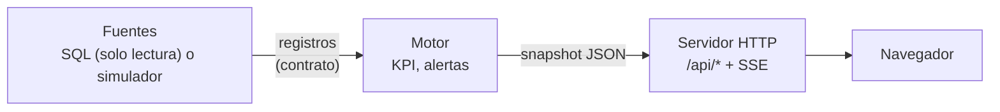

# Contratos entre módulos

Este documento fija las interfaces entre fuentes de datos, motor y salida. Su objetivo es que el modo
DEMO y el modo SQL pasen por exactamente el mismo código: el motor nunca sabe de dónde vienen los registros.



Estado: el contrato de registros (§1), los parámetros (§2) y el snapshot de ejemplo (§3) están implementados
y probados. La API HTTP (§4), las alertas (§5) y el frontend (§6) son diseño previsto.

## 1. Registros (fuente → motor)

Definidos en `backend/despacho/contratos.py` (`DATASETS`). Cada dataset es una lista de `dict` con
columnas y tipos fijos (`fecha`, `fechahora`, `texto`, `entero`, `decimal`; el sufijo `?` admite `None`).
La fuente SQL ejecuta `sql/consultas/<archivo>.sql`; el simulador produce las mismas columnas.
`contratos.validar_registros()` verifica el contrato y se usa en los tests, en el simulador previsto y
al activar la conexión real.

| dataset | servidor | tabla origen (esquema demo) | frecuencia | parámetros | consulta incluida |
|---|---|---|---|---|---|
| `horas_equipo` | despacho | `horas_equipo` | 1 min | @FechaOpAyer, @FechaOpHoy | sí |
| `horas_equipo_aux` | despacho | `horas_equipo` | 1 min | @FechaOpAyer, @FechaOpHoy | previsto |
| `ciclos` | despacho | `ciclos` | 30 s | @InicioTurnoAnterior | sí |
| `chancado_descargas` | despacho | `descargas` | 1 min | @FechaOpAyer, @FechaOpHoy | previsto |
| `chancado_hora` | despacho | `descargas` | 1 min | @DesfaseMinutos, @FechaOpAyer, @FechaOpHoy | sí |
| `ley_hora` | despacho | `descargas` | 1 min | @FechaOpAyer, @FechaOpHoy | previsto |
| `velocidad_hora` | despacho | `gps_lecturas` | 1 min | @DesfaseMinutos, @DesdeUtcHistoria, @HastaUtc | sí |
| `gps` | despacho | `gps_lecturas` | 10 s | @DesdeUtc, @HastaUtc, @DesfaseMinutos | sí |
| `estado_equipos` | despacho | `estados_equipo` | 30 s | @AhoraLocal | previsto |
| `plan_caex` | despacho | `planes` | 30 min | @FechaInicioPlanes | sí |
| `plan_carguio` | despacho | `planes` | 30 min | @FechaInicioPlanes | previsto |
| `plan_perforadoras` | despacho | `planes` | 30 min | @FechaInicioPlanes | previsto |
| `plan_chancador` | despacho | `planes` | 30 min | @FechaInicioPlanes | previsto |
| `plan_indicadores` | planta | `valores` | 30 min | @FechaInicioPlanes | sí |
| `equipos` | despacho | `equipos` | 1 h | — | sí |

Un test (`tests/test_contratos.py`) verifica, para cada consulta incluida, que es de solo lectura, que
sus parámetros coinciden con el contrato **en orden de primera aparición** y que cada columna del
contrato aparece como alias en el `SELECT`.

### Interfaz de fuente

```python
class Fuente(Protocol):
    nombre: str                     # 'demo' | 'sql' | 'fija'
    def obtener(self, dataset: str, parametros: dict) -> list[dict]: ...
    def estado(self) -> dict: ...   # para /api/health, sin secretos
```

`CacheDataset` guarda por dataset las filas, la hora del último éxito y del último intento, el error, la
latencia y los fallos seguidos; el programador previsto la expone al constructor de snapshots.

## 2. Parámetros de consulta

Los calcula `datos.base.parametros_consulta(ahora)` a partir del reloj y se pasan como parámetros con nombre;
nunca se concatenan en el texto SQL. `consultas.a_posicional()` los convierte a `?` para drivers ODBC.

| parámetro | tipo | significado |
|---|---|---|
| `@FechaOpHoy`, `@FechaOpAyer` | DATE | día operacional actual y anterior |
| `@InicioTurnoAnterior` | DATETIME | inicio del turno anterior (hora local) |
| `@AhoraLocal` | DATETIME | ahora en hora local |
| `@DesdeUtc`, `@HastaUtc` | DATETIME | ventana GPS en UTC (minutos hacia atrás; +1 h de margen hacia adelante) |
| `@DesdeUtcHistoria` | DATETIME | inicio de la ventana histórica corta (días) en UTC |
| `@DesfaseMinutos` | INT | minutos entre hora local y UTC en ese instante |
| `@FechaInicioPlanes` | DATE | inicio de la ventana de planes (p. ej. 21 días) |

Límite conocido: `@DesfaseMinutos` es un único valor por consulta, así que en ventanas históricas que cruzan un
cambio de horario la conversión de las horas más antiguas puede quedar desplazada una hora.

## 3. Snapshot (motor → navegador)

Un único JSON, regenerado cada 10 s, que describe todo lo que se ve en pantalla. Ejemplo completo y
sintético: `docs/snapshot_ejemplo.json` (lo produce `datos_sinteticos/generar_datos.py`; sirve de fixture).

Reglas:

- Fechas en ISO 8601 con desfase (`2025-05-31T15:03:10+00:00`).
- Números siempre numéricos (nunca texto formateado); el formato regional lo aplica el navegador.
- `null` significa «sin dato» y el navegador muestra «—».
- Cada bloque trae `fuente` (texto explicativo) y, si aplica, `estimado` (campos que provienen de un método
  propio documentado y no de un registro directo).
- Las claves son estables: agregar campos está permitido, renombrar no.

Secciones del ejemplo: `version`, `generado`, `modo`, `estado_datos`, `fuente`, `turno`, `reloj`,
`tarjetas` (`movimiento_mina`, `chancado`, `velocidad_caex`, `equipos_en_uso`), `gaviota`, `ciclos`, `flota`,
`chancado`, `equipos`, `mapa`, `alertas`. Secciones previstas: `match` (pala-camión) y `ia` (recomendaciones).

`estado_datos` ∈ `EN_VIVO | ATRASADO | SIN_CONEXION | DEMO` (reglas en `ARQUITECTURA.md`).

El cierre probable de las tarjetas se calcula como `real + horas restantes × ritmo esperado`, donde el ritmo
esperado mezcla el ritmo de las últimas horas y el ritmo del plan horario (`proyeccion.peso_reciente`); el rango
P10–P90 usa un coeficiente de variación acotado por `proyeccion.cv_minimo` y `cv_maximo`.

## 4. API HTTP (prevista)

| método | ruta | descripción |
|---|---|---|
| GET | `/` | `frontend/index.html` |
| GET | `/css/*`, `/js/*`, `/assets/*` | archivos estáticos (rutas relativas desde `index.html`) |
| GET | `/api/snapshot` | último snapshot |
| GET | `/api/eventos` | Server-Sent Events: `snapshot` cada 10 s, `alerta` al cambiar las alertas, `: ping` cada 15 s |
| GET | `/api/health` | estado del servidor, modo, estado de datos, versión, consultas, zona horaria |
| GET | `/api/alertas?estado=activa\|historial&limite=100` | alertas activas o historial |
| POST | `/api/alertas/<id>/reconocer` | cuerpo `{"por": "nombre"}`; exige la cabecera `X-Token` si `WEB_TOKEN` está definido o el servidor escucha fuera de 127.0.0.1 |
| GET | `/api/config` | configuración pública (sin secretos) |
| GET | `/api/historial/snapshots?desde=&hasta=` | snapshots guardados, resumidos |

Respuestas JSON con `Content-Type: application/json; charset=utf-8` y `Cache-Control: no-store`.
Errores: `{"error": "mensaje"}` con el código HTTP apropiado. Sin CORS abierto (mismo origen).

## 5. Alertas (previsto)

El motor evalúa las reglas de `config/alertas.toml` después del motor de KPI y antes de serializar:

```toml
[[regla]]
id = "equipo_detenido"            # tipo registrado en el motor
nombre = "Equipo de carguío detenido"
severidad = "critica"             # critica | alta | media | informativa
umbral = 30                       # minutos
duracion_min = 0                  # minutos que debe mantenerse la condición antes de activar
histeresis = 5                    # margen para resolver (evita oscilación)
activa = true
accion = "Evaluar el estado de {equipo} y definir cuándo reincorporarlo."
```

Ciclo de vida: `activa → reconocida → resuelta`. Clave de deduplicación = regla + clave (equipo o ruta).
El objeto de alerta está en `alertas.activas[]` del snapshot de ejemplo.

## 6. Frontend (previsto)

Cada panel sería un módulo ES que exporta `init(contenedor)` (crea el DOM estático) y
`render(snapshot, contexto)` (actualiza nodos existentes, sin recrear el DOM). Todas las rutas de
`index.html` serían relativas, de modo que el frontend también pueda servirse con
`python -m http.server` y cargar `docs/snapshot_ejemplo.json` como fixture durante el desarrollo.

## 7. Configuración

- `.env` (secretos y modo): ver `env.ejemplo`. Las variables del proceso tienen prioridad.
- `config/dashboard.toml`: refrescos, ventanas, frescura, formato, parámetros de proyección, mezcla plan de
  chancado, catálogo de prefijos de equipos y planes por defecto.
- `config/alertas.toml`: reglas de alerta.
- `config/plan_horario.toml`: perfil horario del plan (12 pesos por turno que suman 1).
- `config/mapa.toml`: calibración lat/lon → x/y, frentes, destinos y rutas (coordenadas ficticias).
