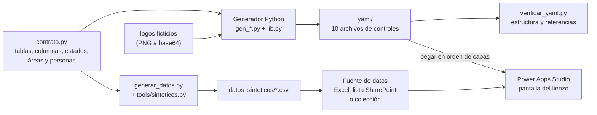

# 05 · Power Apps con código generado: «Agenda del equipo»

> **Datos 100 % sintéticos de la empresa ficticia «Minera Demo».** Las áreas, personas, actividades, logos y colores
> son inventados. Ninguna cifra, nombre ni fuente de datos corresponde a una operación real.

Aplicación de lienzo (Power Apps) para llevar la agenda de un equipo, con siete pestañas: **Por área** (tablero
área × estado), **Tablero** (por estado), **Lista**, **Por persona**, **Highlights y Lowlights**, **Por revisar** e
**Historial**. **Su código YAML no se escribe a mano: lo genera un programa en Python** a partir de un contrato de
datos, y se pega en Power Apps Studio.

## La idea: contract-first y generar el YAML con Python

Una app de lienzo con cientos de controles es difícil de mantener haciendo clic: cada cambio de color, de columna o de
estado obliga a tocar decenas de propiedades. Aquí se invierte el flujo:

1. **Contrato primero.** `generador/contrato.py` declara las tablas, columnas, estados, prioridades, áreas y personas.
   Es la única fuente de verdad: lo usan tanto el generador de YAML como el generador de datos sintéticos.
2. **El YAML es una salida, no un archivo que se edita.** Cada vista es una función Python que arma controles y
   fórmulas Power Fx (`lib.py` tiene los constructores y la paleta). Cambiar un estado, un color o una columna se hace
   en un solo lugar y se regenera todo.
3. **Se pega en Studio** y se conecta a una fuente de datos con las mismas tablas y columnas del contrato.
4. **Verificación estática** antes de pegar (`verificar_yaml.py`): YAML válido, nombres de control únicos, fórmulas con
   delimitadores balanceados y referencias solo a tablas/columnas del contrato.



## Qué demuestra

- **Generación de código** para una interfaz declarativa (YAML de Power Apps) con Python: constructores de controles,
  fórmulas Power Fx como texto y una paleta centralizada.
- **Diseño contract-first**: el mismo contrato alimenta el código de la app y los datos de ensayo.
- **Power Fx avanzado**: `With`, `AddColumns` anidado, `Switch`, `Patch`/`Errors`/`Notify` con manejo de errores,
  borrado con confirmación en dos clics, correlativo de ID por año, orden por encabezado clicable y galerías de altura
  flexible (las tarjetas crecen con su texto; la altura de cada celda se mide con etiquetas ocultas).
- **Datos sintéticos reproducibles** con semilla fija y validación de invariantes (fechas dentro del periodo, estados
  coherentes con la bitácora, IDs únicos).
- **Verificación sin Studio**: comprobaciones estáticas del YAML generado; la salida es determinista (regenerar
  produce archivos idénticos), de modo que un cambio en `yaml/` siempre se explica por un cambio en el generador.

## Estructura

```
05-power-apps-codegen/
├── README.md
└── agenda-equipo/
    ├── requirements.txt            PyYAML (solo para verificar_yaml.py)
    ├── generador/
    │   ├── contrato.py             tablas, columnas, estados, áreas, personas (fuente de verdad)
    │   ├── lib.py                  paleta Minera Demo y constructores de controles YAML
    │   ├── comun.py                fórmulas, filtros, galerías y tarjetas compartidas por las vistas
    │   ├── ids.py                  regla del ID correlativo (A-01-yy) en Python y en Power Fx
    │   ├── gen_encabezado.py       franja superior con logos, resumen, filtros   -> 01_encabezado.yaml
    │   ├── gen_pestanas_y_vistas.py  pestañas, Tablero, Lista, Por persona      -> 01b, 04, 05, 06
    │   ├── gen_tablero_por_area.py   vista Por área (filas flexibles)           -> 02_tablero_por_area.yaml
    │   ├── gen_highlights.py       Highlights y Lowlights                        -> 07_vista_highlights.yaml
    │   ├── gen_revisar.py          Por revisar (crear/posponer/descartar)        -> 08_vista_revisar.yaml
    │   ├── gen_historial.py        actividades terminadas                        -> 09_vista_historial.yaml
    │   ├── gen_paneles.py          velo y paneles de edición                     -> 03_paneles.yaml
    │   ├── panel_actividad.py, panel_highlights.py, panel_revisar.py, panel_comun.py
    │   ├── generar_todo.py         ejecuta todo y verifica
    │   ├── verificar_yaml.py       verificación estática de los YAML
    │   ├── trocear_yaml.py         utilidad opcional: parte los YAML en trozos pequeños
    │   └── logos/                  logo e ícono ficticios (se incrustan como base64)
    ├── yaml/                       salida del generador (10 archivos, ~400 controles)
    └── datos_sinteticos/
        ├── generar_datos.py        genera los CSV (usa tools/sinteticos.py y el contrato)
        └── *.csv                   actividades, areas, personas, por_revisar, highlights_lowlights,
                                    estados, historial_estados
```

## Cómo regenerar

Requisitos: Python 3.10 o superior. Para la verificación, `pip install -r agenda-equipo/requirements.txt`.

```bash
cd 05-power-apps-codegen/agenda-equipo/generador
python generar_todo.py            # reescribe ../yaml/*.yaml y los verifica

cd ../datos_sinteticos
python generar_datos.py           # reescribe los CSV (semilla fija: salida idéntica en cada ejecución)
```

`generar_datos.py` importa `tools/sinteticos.py` desde la raíz del repositorio (ruta relativa al archivo), así que se
ejecuta desde cualquier carpeta pero dentro del repositorio completo.

**Cambios típicos**

| Quiero… | Dónde |
|---|---|
| Agregar o renombrar un estado, un área o una persona | `contrato.py` (y, si cambia el flujo, `comun.py` para su color) |
| Cambiar colores o tipografía | `lib.py` (paleta `C`) y `comun.py` (chips y líneas de estado) |
| Cambiar el layout de una vista | su `gen_*.py` |
| Cambiar los logos | reemplazar los PNG de `generador/logos/` y regenerar |

## Cómo pegar el YAML en Power Apps Studio

1. Crear una app de lienzo en blanco (formato tableta) y una pantalla vacía. Las coordenadas están pensadas para un
   lienzo de **1366 × 768** (el contenido llega hasta x ≈ 1334, y ≈ 756).
2. Agregar primero la fuente de datos (sección siguiente): las fórmulas ya referencian `Actividades`, `Areas`,
   `Personas`, `PorRevisar` y `HighlightsLowlights`.
3. Pegar los archivos de `yaml/` **en este orden de capas** (el primero queda al fondo):

   | # | Archivo | Contenido |
   |---|---|---|
   | 1 | `01_encabezado.yaml` | fondo, franja con logos, resumen, buscar, filtro, títulos de columna |
   | 2 | `01b_pestanas.yaml` | siete pestañas y subrayado de la activa |
   | 3 | `02_tablero_por_area.yaml` | vista Por área (la de arranque) |
   | 4 | `04_vista_tablero.yaml` | vista Tablero |
   | 5 | `05_vista_lista.yaml` | vista Lista |
   | 6 | `06_vista_persona.yaml` | vista Por persona |
   | 7 | `07_vista_highlights.yaml` | vista Highlights y Lowlights |
   | 8 | `08_vista_revisar.yaml` | vista Por revisar |
   | 9 | `09_vista_historial.yaml` | vista Historial |
   | 10 | `03_paneles.yaml` | velo, paneles de edición y botones ocultos `reset` |

   Si un archivo es muy grande para pegarlo de una vez, `python trocear_yaml.py` lo parte en trozos de control completo
   (carpeta `yaml_trozos/`, no versionada) que se pegan uno tras otro.
4. Guardar y ejecutar. Las variables (`varVista`, `varAct`, `varModo`, `varPanel`…) se crean con `Set()` al usarlas y la
   vista de arranque es «Por área» (`Coalesce(varVista, "area")`); en principio no hace falta inicializarlas en
   `App.OnStart` (no probado).

## Cómo cargar los CSV como fuente de datos

Los CSV están en UTF-8 con BOM (Excel respeta las tildes) y las fechas son **texto ISO** `yyyy-mm-dd`, que la app convierte
con `DateValue()`. Cada CSV es una tabla del contrato:

| CSV | Tabla en la app | Columnas |
|---|---|---|
| `actividades.csv` | `Actividades` | ID, Area, Actividad, Descripcion, Responsable, Contraparte, Prioridad, Estado, FechaInicio, FechaCompromiso, FechaTermino, StatusActual, Bloqueo |
| `areas.csv` | `Areas` | Area, Orden |
| `personas.csv` | `Personas` | Nombre, NombreCompleto, Iniciales, Correo |
| `por_revisar.csv` | `PorRevisar` | Tema, Detalle, Contraparte, ResponsablePropuesto, Decision, Fecha |
| `highlights_lowlights.csv` | `HighlightsLowlights` | Tipo, Fecha, Tema, Detalle, Impacto, Accion, Responsable |
| `estados.csv` | (referencia) | Codigo, Estado, Orden, ColorHex |
| `historial_estados.csv` | (referencia) | ID, Fecha, EstadoAnterior, EstadoNuevo, Usuario |

La app **no** consulta `estados.csv` (los estados están en sus fórmulas) ni `historial_estados.csv` (la vista Historial
filtra `Actividades` por `Estado = "Terminada"`); son material de referencia y de auditoría.

**Opción A: libro de Excel (la más directa).**
1. Abrir cada CSV en Excel (Datos → Desde texto/CSV, origen UTF-8) y pasarlos a un libro, uno por hoja.
2. Dar formato de tabla (Ctrl+T) y poner a cada tabla **exactamente** el nombre de la columna «Tabla en la app» de arriba.
3. Guardar el libro en un OneDrive o SharePoint de ensayo (los `.xlsx` no se versionan en este repositorio).
4. En Studio: Datos → Agregar datos → Excel Online (Business) y elegir las cinco tablas.

**Opción B: listas de SharePoint.** Crear una lista por tabla con las mismas columnas (todas de texto, incluidas las
fechas y `Orden`) e importar los CSV. Hay que reemplazar los marcadores de sitio y de lista de la conexión por los
propios (`<URL_DEL_SITIO>`, `<NOMBRE_DE_LA_LISTA>`): el YAML no contiene ninguna URL ni identificador.

**Opción C: solo para ver el diseño.** Importar las tablas como datos estáticos o colecciones con los mismos nombres.
Permiten ver las vistas sin conectar nada, pero los cambios no persisten y `Refresh()`/`Errors()` pueden no comportarse como
con una fuente real (no probado).

## Buenas prácticas

- **Guardar en Studio con frecuencia** y publicar una versión antes de pegar YAML grande; trabajar siempre sobre una
  copia de la app.
- **No editar el YAML a mano.** Si hay que cambiar algo, cambiar el generador (o el contrato) y regenerar; así los
  cambios no se pierden en el siguiente pegado y los nombres de control siguen siendo únicos.
- **Probar en distintos tamaños de pantalla**: tableta 1024 × 768 y 1120 × 640, además del lienzo base de 1366 × 768.
  Con «Ajustar a la pantalla» las proporciones cambian; revisar que las galerías de altura flexible, la columna derecha
  y los paneles de edición se vean completos.
- **No escribir datos de ensayo en datos reales.** Guardar, Eliminar y «Crear actividad» ejecutan `Patch`/`Remove`
  directamente sobre la fuente conectada. Para ensayar, conectar una copia con los CSV sintéticos.
- **Delegación**: varias vistas usan `Filter` con `in` y `Sort` con expresiones calculadas; con listas grandes en Excel
  o SharePoint Studio mostrará avisos de delegación y solo procesará los primeros registros (límite configurable). Con
  volúmenes mayores conviene Dataverse o SQL y mover los filtros al servidor.
- **Logos**: aquí van incrustados como base64 para no depender de Multimedia; en una app real es preferible subirlos
  como recursos.
- **Contrato antes que código**: cualquier columna nueva se declara en `contrato.py`, se regenera y se corre
  `verificar_yaml.py` antes de pegar.

## Qué funciona y qué no se pudo probar

- **Verificado (estático)**: los 10 YAML se parsean con PyYAML, los 400 y tantos nombres de control son únicos, todas
  las fórmulas tienen delimitadores balanceados y solo referencian tablas y columnas del contrato; los CSV pasan sus
  invariantes (60-120 actividades, fechas entre 2025-03-03 y 2025-05-31, IDs únicos, bitácora coherente con el estado final).
- **No probado**: **esta copia no se pudo abrir ni ejecutar en Power Apps Studio.** No se ha verificado el pegado, el
  comportamiento de las galerías de altura flexible, el rendimiento ni la compatibilidad con las versiones de control
  usadas (p. ej. `Gallery@2.15.0`, `Classic/Button@2.2.0`): si tu Studio ofrece otras versiones, habrá que ajustarlas en
  `lib.py` y `comun.py`.
- **Limitaciones conocidas**: la lista del filtro «Responsable» y la vista «Por persona» muestran a las tres primeras
  personas del contrato; el indicador «En vivo» es decorativo; la app no tiene control de usuarios ni de permisos más
  allá de los de la fuente de datos.

## Aviso

Todo el contenido es de la empresa ficticia **Minera Demo**: nombres, logos, personas (`Persona Demo NN`, correos
`@minera-demo.example`), áreas, actividades y fechas son sintéticos y no sirven para decisiones reales. Power Apps,
Power Fx, SharePoint y Excel son marcas de sus respectivos titulares; este repositorio no tiene afiliación con ellos.
