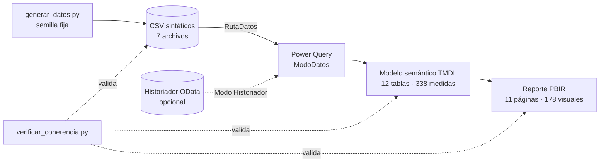

# 06 · Gestión del agua de una operación minera (Power BI nativo)

> **Datos 100 % sintéticos de la empresa ficticia Minera Demo.** Ningún valor, nombre, señal ni límite proviene de una
> operación real. Los umbrales son «límites de ejemplo», no normas ni límites regulatorios.

Tablero ambiental en Power BI nativo (modelo TMDL + reporte PBIR) centrado en la **gestión del agua**: captación, agua
fresca, agua recuperada y recirculada, consumo por área, niveles de tranque y estanques, calidad (pH, conductividad,
turbidez) y calidad del dato. Incluye el generador de datos sintéticos y un verificador de coherencia del modelo.

## Qué demuestra

- **Modelado semántico en TMDL**: tablas, relaciones, parámetros de Power Query y 338 medidas DAX organizadas en 13 familias.
- **Reporte PBIR versionable**: 11 páginas y 178 visuales en JSON, con formato condicional por medida y paleta propia.
- **Motor de alarmas en DAX**: un solo cálculo de severidad sobre el tipo de activo (sin dato, congelado, sobre HI/HH, posible
  corte de energía, cupo mensual) con una alarma por estación cuando toda ella pierde comunicación.
- **Balance hídrico coherente**: agua fresca + agua recuperada = agua total; consumo por área con cierre menor a 1 %.
- **Datos sintéticos reproducibles** (`datos_sinteticos/generar_datos.py`, semilla fija, 90 días desde 2025-03-03) y
  **verificador** que valida referencias DAX, campos de visuales, relaciones y CSV sin abrir Power BI.
- **Fuente intercambiable**: el parámetro `ModoDatos` alterna entre CSV sintético y un historiador de proceso por OData.



## Estructura

```text
06-sustentabilidad-agua/
├── pbip/
│   ├── gestion-agua-demo.pbip
│   ├── gestion-agua-demo.SemanticModel/   modelo TMDL (tablas, medidas, relaciones, parámetros)
│   ├── gestion-agua-demo.Report/          reporte PBIR (páginas, visuales, tema, logos ficticios)
│   └── configurar_ruta.py                 apunta RutaDatos a tu copia local
├── datos_sinteticos/
│   ├── generar_datos.py                   generador reproducible
│   └── *.csv                              catálogos, mediciones horarias, balance diario, laboratorio, config
├── tools/verificar_coherencia.py          verificador de coherencia del modelo y el reporte
├── mockups/sinoptico-agua-demo.html       mockup estático (HTML/CSS/JS autocontenido)
└── docs/                                  modelo de datos, catálogo de medidas y criterios de diseño
```

## Cómo abrirlo

1. (Opcional) regenerar los datos: `python datos_sinteticos/generar_datos.py` (los CSV ya vienen generados).
2. Apuntar el parámetro `RutaDatos` a tu copia: `python pbip/configurar_ruta.py`
   (antes de hacer commit: `python pbip/configurar_ruta.py --restaurar`). También se puede cambiar en Power BI Desktop:
   *Transformar datos > Administrar parámetros > RutaDatos*, con barra final.
3. Abrir `pbip/gestion-agua-demo.pbip` en Power BI Desktop (con las vistas previas de PBIP y TMDL activadas) y actualizar.

El reloj del modelo queda fijo 20 min después de la última muestra del CSV (31-05-2025 23:20), de modo que el tablero se ve «en vivo» sin
depender de la fecha real. Los escenarios sembrados (pozo detenido, corte de energía, tranque subiendo, pH fuera de banda,
estación sin comunicación) están descritos en `docs/modelo-de-datos.md`.

## Verificación

```text
python tools/verificar_coherencia.py      # modelo + reporte + CSV: debe terminar en «COHERENTE: 0 errores»
```

Valida 199 archivos JSON, 12 tablas, 4 relaciones (claves únicas e integridad referencial), todas las referencias DAX y las de
los visuales (556 referencias a campos) y que los literales usados en medidas y filtros existan en los datos.

## Alcance y límites

- **Verificado**: JSON válido, referencias cruzadas modelo-reporte-datos, tipos de las columnas CSV y coherencia del balance.
- **No probado**: no se abrió en Power BI Desktop ni se evaluaron las medidas DAX con un motor; el verificador valida
  referencias y estructura, no resultados. Es posible que Desktop pida ajustes menores de formato al primer guardado.
- **Rama `Historiador`**: es una referencia del contrato esperado de un OData de proceso (`Samples` e `Items`); usa URL de
  ejemplo y no se probó contra un servidor real.
- **Mockups**: se incluye un único diseño estático nuevo (sinóptico de proceso) con valores inventados.

Autor: Alejandro Porcile Henry
