# 06 · Gestión del agua de una operación minera (Power BI nativo)

> **Datos 100 % sintéticos de la empresa ficticia Minera Demo.** Ningún valor, nombre, señal ni límite proviene de una
> operación real. Los umbrales son «límites de ejemplo», no normas ni límites regulatorios.

Tablero ambiental en Power BI nativo (modelo TMDL + reporte PBIR) centrado en la **gestión del agua**: captación, agua
fresca, agua recuperada y recirculada, consumo por área, niveles de tranque y estanques, calidad (pH, conductividad,
turbidez) y calidad del dato. Incluye el generador de datos sintéticos y un verificador de coherencia del modelo.

## Cómo se ve

> Las imágenes son **renders del diseño** (1920 × 1080), dibujados con las posiciones y las reglas de las medidas DAX del proyecto y con los datos sintéticos de la
> carpeta `datos_sinteticos/`. No son capturas de Power BI Desktop. Los umbrales que aparecen son «límites de ejemplo».

<p align="center"><a href="capturas/vista_general.png">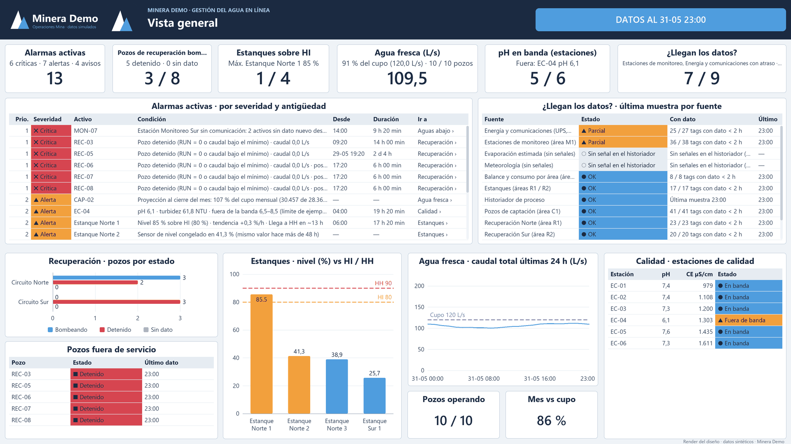</a></p>

**Vista general.** Qué requiere atención ahora: 13 alarmas activas (6 críticas, 7 alertas), pozos de recuperación bombeando, estanque sobre el límite HI, agua fresca frente
al cupo y llegada de datos por fuente.

<table>
<tr>
<td width="50%"><a href="capturas/balance_hidrico.png">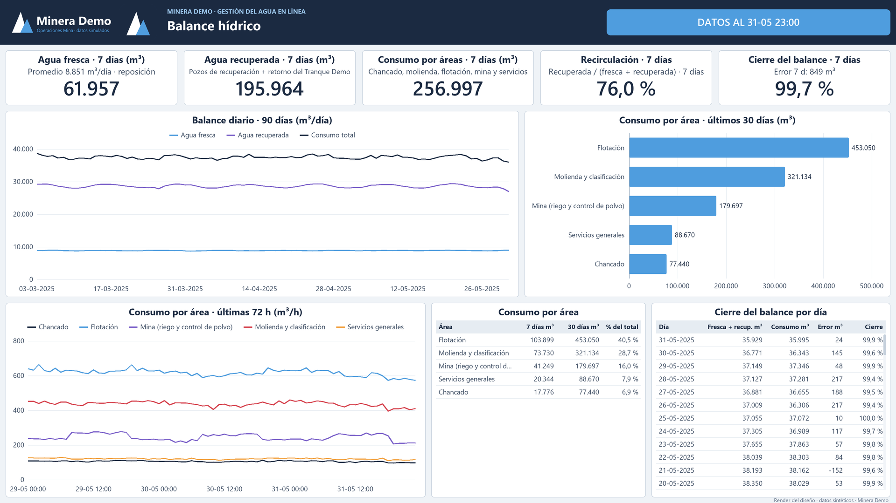</a><br><b>Balance hídrico.</b> Agua fresca, agua recuperada y consumo a 7 días, recirculación (76 %), cierre del balance (99,7 %) y consumo por área.</td>
<td width="50%"><a href="capturas/captacion.png">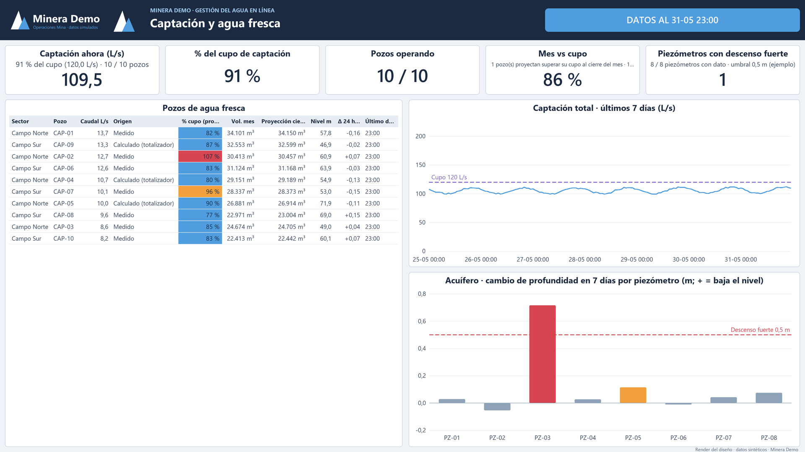</a><br><b>Captación y agua fresca.</b> Captación frente al cupo de 120 L/s, proyección mensual por pozo y cambio de profundidad en 7 días de los piezómetros.</td>
</tr>
<tr>
<td width="50%"><a href="capturas/recuperacion_agua.png">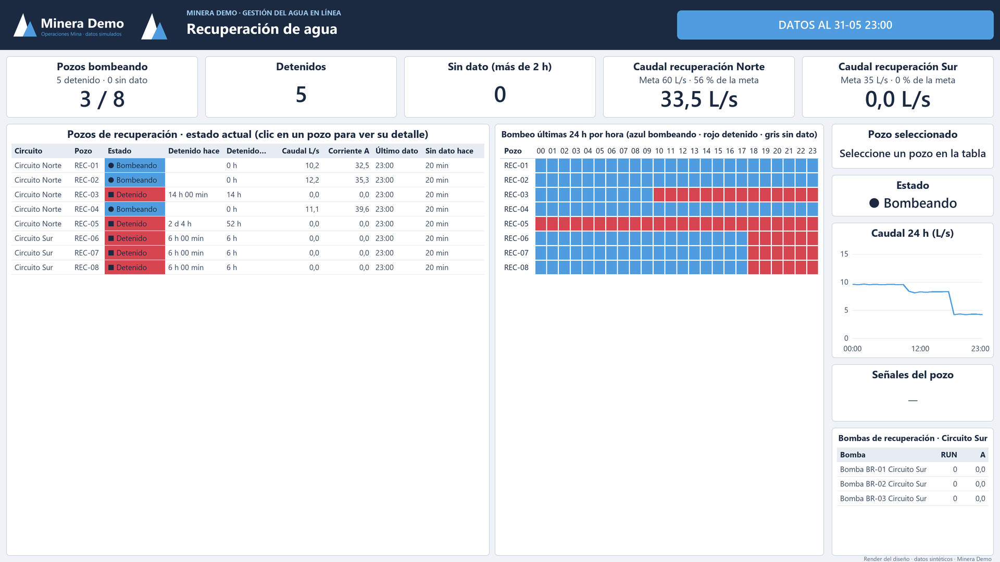</a><br><b>Recuperación de agua.</b> Estado de los 8 pozos de recuperación (5 detenidos), matriz de bombeo de 24 h y bombas del circuito sur.</td>
<td width="50%"><a href="capturas/estanques.png">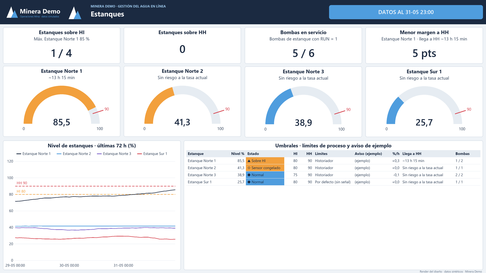</a><br><b>Estanques.</b> Medidores de nivel con línea HH, tendencia de 72 h y tabla de umbrales con el tiempo estimado para llegar a HH.</td>
</tr>
<tr>
<td width="50%"><a href="capturas/tranques_y_pozas.png">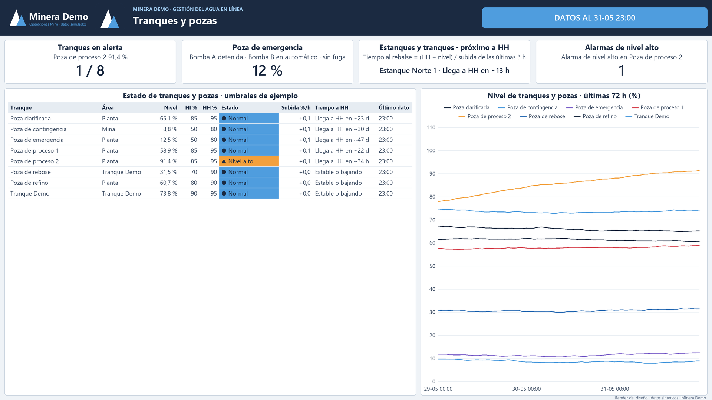</a><br><b>Tranques y pozas.</b> Los 8 tranques y pozas con nivel, límites HI/HH, estado, subida por hora y tiempo a HH.</td>
<td width="50%"><a href="capturas/aguas_abajo.png">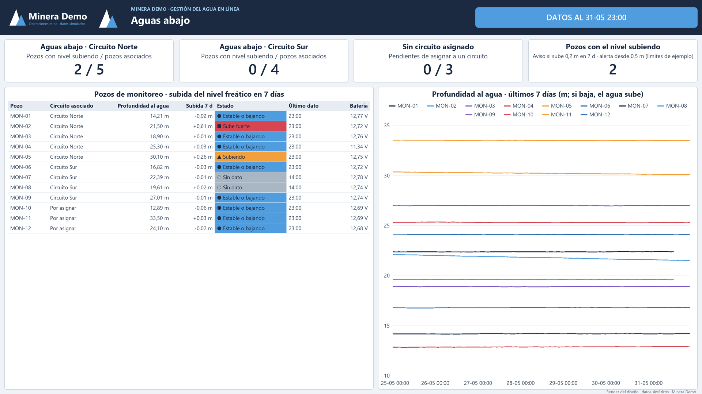</a><br><b>Aguas abajo.</b> Pozos de monitoreo del nivel freático: cuáles suben en 7 días, estado, batería y profundidad al agua.</td>
</tr>
<tr>
<td width="50%"><a href="capturas/calidad_agua.png">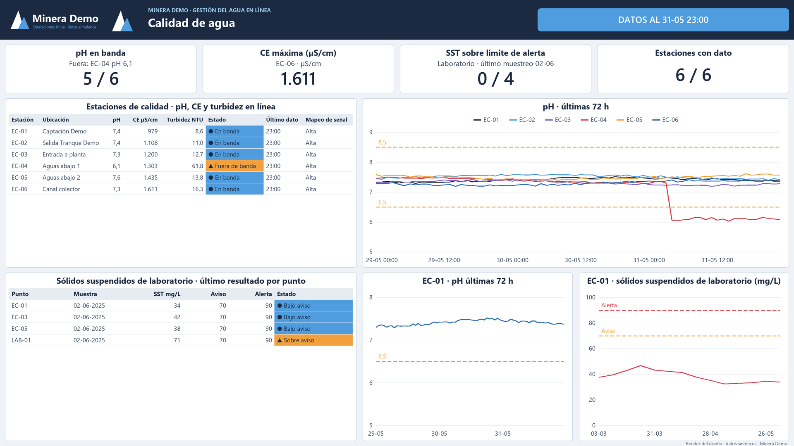</a><br><b>Calidad de agua.</b> pH, conductividad y turbidez en línea de 6 estaciones (una fuera de banda) y sólidos suspendidos de laboratorio con sus límites.</td>
<td width="50%"><a href="capturas/semaforos.png">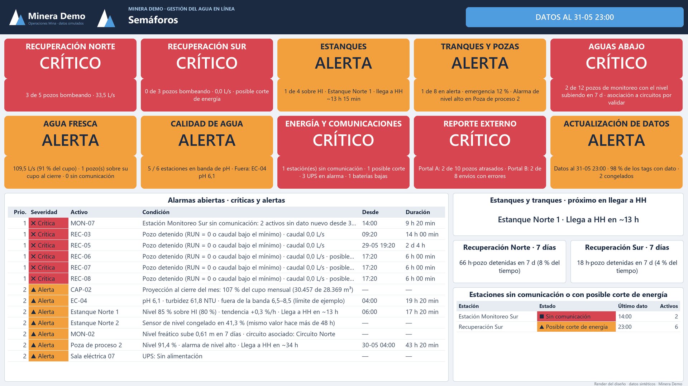</a><br><b>Semáforos.</b> Un semáforo por sistema (5 críticos, 5 en alerta) con su detalle y las alarmas abiertas.</td>
</tr>
<tr>
<td width="50%"><a href="capturas/energia_reporte.png">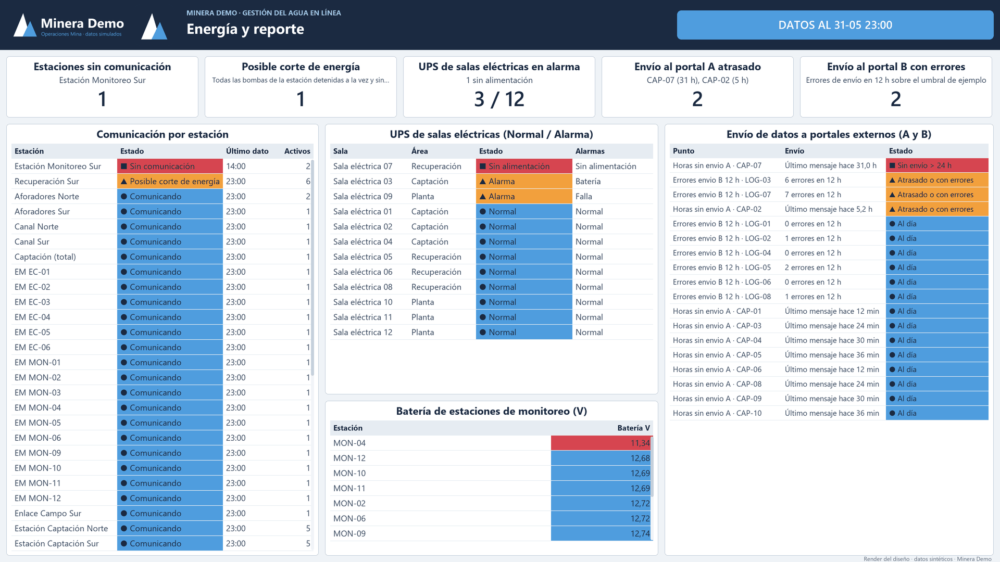</a><br><b>Energía y reporte.</b> Comunicación por estación, UPS de salas eléctricas, baterías de monitoreo y envíos a los portales de reporte.</td>
<td width="50%"><a href="capturas/senales_calidad_dato.png">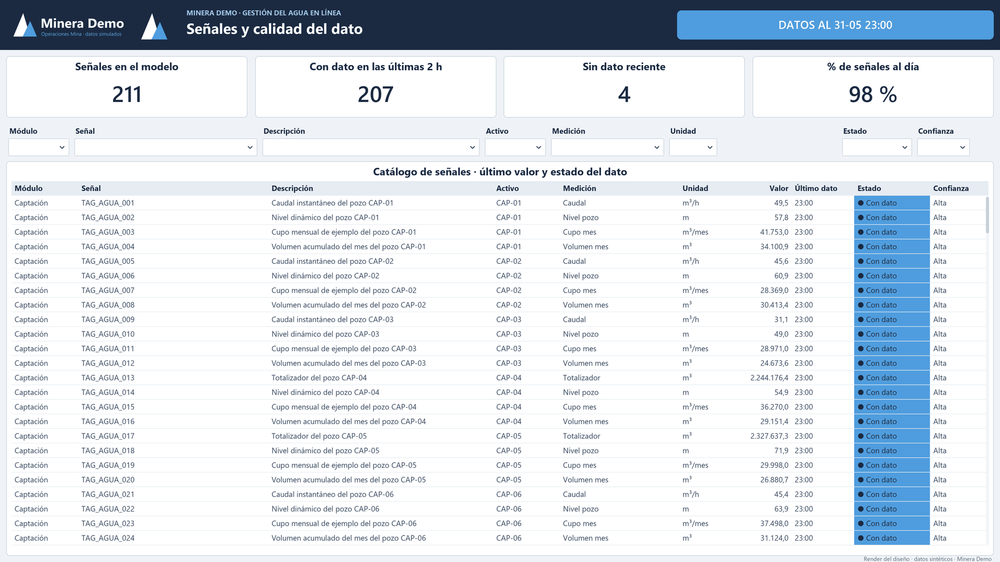</a><br><b>Señales y calidad del dato.</b> Catálogo de 211 señales con su último valor y el estado del dato (207 al día, 4 sin dato reciente).</td>
</tr>
</table>

## Qué hice

**El problema.** Monitorear casi en tiempo real la captación, el consumo, la recirculación y la calidad del agua de una operación, y saber a qué prestar atención primero.

**Cómo lo abordé**

1. **Un motor de alarmas en DAX.** Un solo cálculo de severidad según el tipo de activo (sin dato, congelado, sobre HI o HH, posible corte de energía, cupo mensual), con
   una alarma por estación cuando toda ella pierde comunicación, para que el tablero ordene lo urgente y no solo lo muestre.
2. **Un balance que cierra.** Agua fresca más agua recuperada es el agua total, y el consumo por área cierra con menos de 1 % de diferencia.
3. **Una fuente intercambiable.** El parámetro `ModoDatos` alterna entre el CSV sintético y un historiador de proceso por OData, sin tocar el modelo.
4. **Datos con escenarios sembrados.** Un pozo detenido, un corte de energía, un tranque subiendo, un pH fuera de banda y una estación sin comunicación, para comprobar
   que cada alarma se enciende.
5. **Verificación sin abrir Power BI.** Un verificador valida los 199 archivos JSON, las relaciones, todas las referencias DAX y las de los visuales (556 referencias a campos).

**El resultado.** Un informe de 11 páginas y 178 visuales sobre un modelo de 12 tablas y 338 medidas organizadas en 13 familias, con 211 señales sintéticas; el verificador termina en
«COHERENTE: 0 errores».

## Qué demuestra

- **Modelado semántico en TMDL**: tablas, relaciones, parámetros de Power Query y 338 medidas DAX organizadas en 13 familias.
- **Reporte PBIR versionable**: 11 páginas y 178 visuales en JSON, con formato condicional por medida y paleta propia.
- **Motor de alarmas en DAX**: un solo cálculo de severidad sobre el tipo de activo (sin dato, congelado, sobre HI/HH, posible
  corte de energía, cupo mensual) con una alarma por estación cuando toda ella pierde comunicación.
- **Balance hídrico coherente**: agua fresca + agua recuperada = agua total; consumo por área con cierre menor a 1 %.
- **Datos sintéticos reproducibles** (`datos_sinteticos/generar_datos.py`, semilla fija, 90 días desde 2025-03-03) y
  **verificador** que valida referencias DAX, campos de visuales, relaciones y CSV sin abrir Power BI.
- **Fuente intercambiable**: el parámetro `ModoDatos` alterna entre CSV sintético y un historiador de proceso por OData.

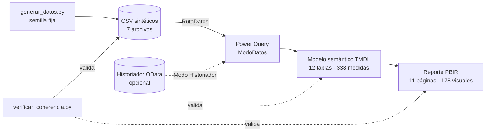

<details>
<summary><b>Detalles técnicos</b>: estructura, cómo abrirlo y cómo verificar</summary>

## Estructura

```text
06-sustentabilidad-agua/
├── pbip/
│   ├── gestion-agua-demo.pbip
│   ├── gestion-agua-demo.SemanticModel/   modelo TMDL (tablas, medidas, relaciones, parámetros)
│   ├── gestion-agua-demo.Report/          reporte PBIR (páginas, visuales, tema, logos ficticios)
│   └── configurar_ruta.py                 apunta RutaDatos a tu copia local
├── datos_sinteticos/
│   ├── generar_datos.py                   generador reproducible
│   └── *.csv                              catálogos, mediciones horarias, balance diario, laboratorio, config
├── tools/verificar_coherencia.py          verificador de coherencia del modelo y el reporte
├── mockups/sinoptico-agua-demo.html       mockup estático (HTML/CSS/JS autocontenido)
└── docs/                                  modelo de datos, catálogo de medidas y criterios de diseño
```

## Cómo abrirlo

1. (Opcional) regenerar los datos: `python datos_sinteticos/generar_datos.py` (los CSV ya vienen generados).
2. Apuntar el parámetro `RutaDatos` a tu copia: `python pbip/configurar_ruta.py`
   (antes de hacer commit: `python pbip/configurar_ruta.py --restaurar`). También se puede cambiar en Power BI Desktop:
   *Transformar datos > Administrar parámetros > RutaDatos*, con barra final.
3. Abrir `pbip/gestion-agua-demo.pbip` en Power BI Desktop (con las vistas previas de PBIP y TMDL activadas) y actualizar.

El reloj del modelo queda fijo 20 min después de la última muestra del CSV (31-05-2025 23:20), de modo que el tablero se ve «en vivo» sin
depender de la fecha real. Los escenarios sembrados (pozo detenido, corte de energía, tranque subiendo, pH fuera de banda,
estación sin comunicación) están descritos en `docs/modelo-de-datos.md`.

## Verificación

```text
python tools/verificar_coherencia.py      # modelo + reporte + CSV: debe terminar en «COHERENTE: 0 errores»
```

Valida 199 archivos JSON, 12 tablas, 4 relaciones (claves únicas e integridad referencial), todas las referencias DAX y las de
los visuales (556 referencias a campos) y que los literales usados en medidas y filtros existan en los datos.

</details>

## Alcance y límites

- **Verificado**: JSON válido, referencias cruzadas modelo-reporte-datos, tipos de las columnas CSV y coherencia del balance.
- **No probado**: no se abrió en Power BI Desktop ni se evaluaron las medidas DAX con un motor; el verificador valida
  referencias y estructura, no resultados. Es posible que Desktop pida ajustes menores de formato al primer guardado.
- **Rama `Historiador`**: es una referencia del contrato esperado de un OData de proceso (`Samples` e `Items`); usa URL de
  ejemplo y no se probó contra un servidor real.
- **Mockups**: se incluye un único diseño estático nuevo (sinóptico de proceso) con valores inventados.

Autor: Alejandro Porcile Henry
