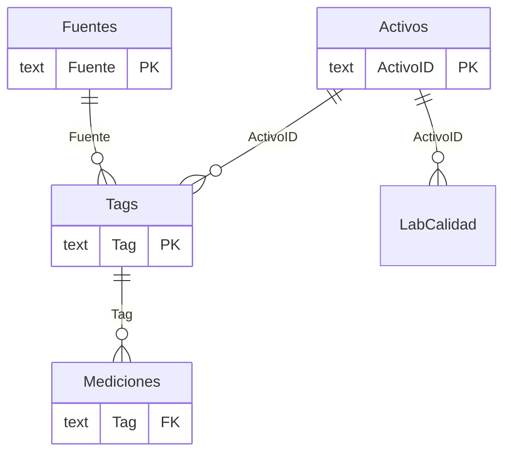

# Modelo de datos

Modelo semántico en formato TMDL (`pbip/gestion-agua-demo.SemanticModel`). Todo el contenido es ficticio: la empresa es
«Minera Demo» y los datos salen de `datos_sinteticos/generar_datos.py`.

## Diagrama

`BalanceDiario`, `Config`, `Horas24`, `Actualizacion`, `Semaforo` y `FiltroEstado` son tablas sin relación: se usan como
hecho independiente (balance), parámetros, eje auxiliar o selector desconectado.

## Tablas

| Tabla | Grano | Origen | Para qué sirve |
|---|---|---|---|
| `Mediciones` | señal x hora (8 días, 1 h) | `mediciones_horarias.csv` | Hechos en formato largo `Tag, FechaHora, Valor`; M agrega `Hora`, `HorasAtras` y `Fecha`. |
| `Tags` | una fila por señal (`TAG_AGUA_001...`) | `catalogo_senales.csv` | Activo, medición, unidad, fuente, módulo y señal principal. |
| `Activos` | pozo, estanque, tranque, estación, sala, área de consumo | `catalogo_activos.csv` | Tipo, grupo, circuito, estación de comunicación y límites HI/HH. Es el eje de las alarmas. |
| `Fuentes` | grupo de origen del dato | `fuentes.csv` | Servidor, áreas y fuentes «sin señal» para la página de calidad del dato. |
| `LabCalidad` | punto x semana | `lab_calidad.csv` | Sólidos suspendidos de laboratorio con límites de aviso y alerta de ejemplo. |
| `BalanceDiario` | día x concepto x área (90 días) | `balance_diario.csv` | Captación, pérdida, agua fresca, agua recuperada, consumo y variación de almacenamiento. |
| `Config` | un parámetro por fila | `config.csv` + 2 filas calculadas | Umbrales editables (todos «de ejemplo») y modo de datos. |
| `Horas24` | 24 filas | M | Columnas de la matriz de bombeo de 24 h. |
| `Actualizacion` | 1 fila | M | Reloj del modelo (`HoraReferencia`). |
| `Semaforo`, `FiltroEstado` | tablas calculadas (`DATATABLE`) | DAX | Sistemas de la página Semáforos y filtro del estado del dato. |
| `Medidas` | tabla de medidas | DAX | 338 medidas en 13 carpetas (ver `catalogo-de-medidas.md`). |

## Parámetros de Power Query

| Parámetro | Valor por defecto | Uso |
|---|---|---|
| `ModoDatos` | `CSV sintético` | `CSV sintético` lee `datos_sinteticos`; `Historiador` lee un OData de proceso. |
| `RutaDatos` | `<RUTA_DEL_REPO>\...\datos_sinteticos\` | Carpeta de los CSV (con barra final). `python pbip/configurar_ruta.py` la rellena. |
| `HistoriadorODataUrl` / `HistoriadorODataUrlEstado` | `https://historiador.example/odata/...` | Marcadores: solo tienen efecto en modo `Historiador`. |
| `ZonaHorariaUTC` | `-4` | Desfase del sitio respecto de UTC. |
| `VentanaDias` | `8` | Días de historia en modo `Historiador`. |

## Reloj del modelo

El tablero compara todo contra «ahora». Con datos sintéticos «ahora» no puede ser la fecha real, así que la expresión
`HoraReferencia` vale **última muestra del CSV + 20 min** (2025-05-31 23:20) y la medida `Ahora` la lee de
`Actualizacion[HoraReferencia]`. En modo `Historiador` ambas son `UTCNOW()` desplazado por `ZonaHorariaUTC`.

## Relaciones físicas de los datos

- `captación = suma del caudal de los pozos de captación`; `agua fresca = captación - pérdida de conducción`.
- `agua total de proceso = agua fresca (reposición) + agua recuperada` (pozos de recuperación + retorno del Tranque Demo).
- `consumo por área = (agua total - variación de almacenamiento)` repartido entre cinco áreas, con error de cierre menor a 1 %.
- Las series horarias de los últimos 8 días suman exactamente el balance diario de esos días (el generador lo verifica al terminar).
- Volumen mensual por pozo = acumulado desde el 1 de mayo; el cupo mensual es de ejemplo y deja un pozo sobre 100 % y otro sobre 90 %.

## Escenarios sembrados

El generador deja a propósito casos que activan el motor de alarmas: una estación con posible corte de energía, un pozo
detenido varios días, un estanque con nivel congelado, un tranque que sube hacia HH, pH y turbidez fuera de banda, dos pozos de
monitoreo sin comunicación, UPS en alarma, envíos atrasados a los portales A y B y un pozo sobre su cupo mensual.
