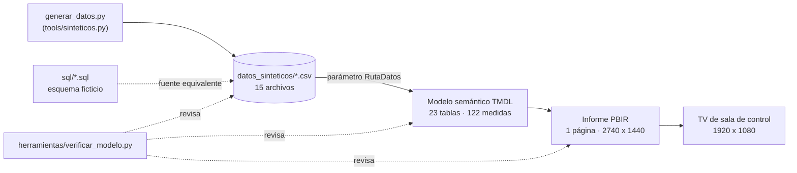

# Centro de Operaciones: informe Power BI para pantalla de sala de control (PBIP)

Informe de una sola página, pensado para una **TV de 1920 × 1080 en una sala de control** de una mina a rajo abierto: lienzo de 2740 × 1440, fondo oscuro, sin
panel de filtros ni nada que tocar. Muestra el día operacional en curso: flota de camiones, palas y perforadoras contra plan, movimiento y chancado por hora,
ley de alimentación, ciclos de acarreo, velocidad de los camiones y un mapa de los que van lentos. Está escrito como **proyecto Power BI en texto** (PBIP con
TMDL y PBIR), con datos sintéticos y un verificador de coherencia propio.

> **Aviso: datos 100 % sintéticos de la empresa ficticia Minera Demo.** No hay datos reales, equipos reales, personas, servidores ni marcas de ninguna empresa.
> Los CSV los genera `datos_sinteticos/generar_datos.py`; los logos son ficticios. Las coordenadas del mapa son un punto arbitrario sin relación con ninguna faena.

## Qué demuestra

- **Diseño para pantalla de sala de control**: lectura a distancia, color con significado (solo el semáforo usa verde y rojo), cero interacción, «Dia actual» que
  avanza solo y hora de última actualización siempre visible. Criterios y contrastes medidos en [`docs/criterios_pantalla_sala_control.md`](docs/criterios_pantalla_sala_control.md).
- **Modelo semántico real de operaciones de mina**: 23 tablas, 122 medidas DAX, 38 relaciones; día operacional de 08:00 a 08:00, turnos A y B, hora del día
  como eje compartido; flotas de Mina y de Muro; real contra plan en todas las matrices.
- **DAX no trivial**: «última hora con datos» por defecto (`CALCULATE` + `REMOVEFILTERS`), proyección a 24 horas, plan filtrado con `TREATAS` por los equipos
  visibles, selectores de métrica con una sola medida por matriz, semáforos devueltos como texto de color, tarjeta SVG de última actualización.
- **Power BI como código**: TMDL y PBIR legibles en Git, sin binarios ni cachés, parámetros `RutaDatos`, `FechaReferencia`, `DiasHistoria` y `DiasHistoriaGPS`.
- **Datos sintéticos coherentes entre sí**: una sola simulación de estados horarios y ciclos genera todas las tablas (lo que cargan las palas es lo que
  descargan los camiones; el chancado sale de los mismos ciclos).
- **SQL equivalente** contra un esquema ficticio (`despacho_demo`, `planta_demo`) y **verificador de coherencia** que cruza modelo, DAX, informe y datos.

## Diagrama



## La pantalla

| Zona | Qué muestra |
|---|---|
| Encabezado | Logo, título, recuadro «última actualización» y segmentador del día (viene en «Dia actual»). |
| Banda de tarjetas | Equipos en uso (Mina y Muro), velocidad promedio de los CAEX por turno, movimiento total y chancado contra plan (en kt), proyecciones a 24 h y ley de alimentación contra plan. |
| Columna izquierda | Resumen de flota Mina (DF, UEBD y rendimiento, real y plan), perforadoras, carguío por equipo y movimiento por hora del turno A y B. |
| Centro | Mapa de CAEX en baja velocidad, alimentación a chancado por origen y hora contra plan, ley de alimentación por fase y hora, y movimiento por hora de Muro. |
| Columna derecha | Tiempo de ciclo y destino actual por pala, resumen de flota Muro y carguío Muro. |

## Estructura

```text
07-centro-operaciones-pbip/
├── pbip/
│   ├── CentroOperacionesDemo.pbip
│   ├── CentroOperacionesDemo.SemanticModel/   # TMDL: tables/, relationships.tmdl, expressions.tmdl, model.tmdl
│   └── CentroOperacionesDemo.Report/          # PBIR: pages/, report.json, StaticResources/ (logos y tema Minera Demo)
├── datos_sinteticos/  # generar_datos.py y los 15 CSV que lee el modelo
├── sql/               # esquema_demo.sql y 6 consultas equivalentes a los CSV
├── herramientas/      # verificar_modelo.py y configurar_ruta.py
└── docs/              # arquitectura_modelo.md, catalogo_medidas.md, criterios_pantalla_sala_control.md
```

## Cómo abrirlo

1. En Power BI Desktop activa las vistas previas **Power BI Project (.pbip)**, **Almacenar modelo semántico en formato TMDL** y **Almacenar informes con
   formato de metadatos mejorado (PBIR)**.
2. Clona el repositorio. Los CSV ya están en `datos_sinteticos/`; para regenerarlos: `python datos_sinteticos/generar_datos.py`.
3. Indica dónde están los datos. Power Query necesita una ruta absoluta y el parámetro `RutaDatos` viene con el valor relativo `..\datos_sinteticos\`, que no
   resuelve desde Power BI Desktop. Fíjalo con el script (queda solo en tu copia) o desde *Transformar datos > Administrar parámetros*:

   ```text
   python herramientas/configurar_ruta.py              # fija RutaDatos a la carpeta local
   python herramientas/configurar_ruta.py --restaurar  # vuelve al valor por defecto antes de hacer commit
   ```

4. Abre `pbip/CentroOperacionesDemo.pbip` y actualiza. El informe abre en «Dia actual», que con los datos de ejemplo es el sábado 31 de mayo de 2025, con el turno B a
   medias (datos hasta las 01:00 del día siguiente) para ver proyecciones y semáforos de un día en curso.

El visual de mapa es Azure Maps; si tu entorno no lo tiene habilitado, el mapa aparece vacío y el resto del informe no depende de él.

## Parámetros

| Parámetro | Valor por defecto | Para qué sirve |
|---|---|---|
| `RutaDatos` | `..\datos_sinteticos\` | Carpeta de los CSV. |
| `FechaReferencia` | `2025-05-31` | Día operacional «en curso». En una instalación real se calcularía con el reloj (cambia a las 08:00). |
| `DiasHistoria` | `90` | Ventana de historia del calendario y de las tablas horarias. |
| `DiasHistoriaGPS` | `7` | Ventana de las tablas de GPS y velocidad. |

## Datos sintéticos

Período de 90 días desde 2025-03-03 (hasta 2025-05-31). Los planes y el calendario cubren los 90 días; el **detalle horario** (horas por equipo, chancado, ley, GPS,
velocidad) cubre los últimos 7 días y el de **ciclos** los últimos 3, para que cada CSV pese menos de 2 MB. Equipos ficticios: `CAEX-01` a `CAEX-26`,
`PALA-01` a `PALA-04`, `CARG-01` y `CARG-02`, `PERF-01` a `PERF-04`, y la flota de Muro con sufijo `_M` (`CAEX-27_M`, `CAEX-28_M`, `CAEX-90_M`, `PALA-05_M`, `CARG-03_M`).
Se incluyen a propósito el CAEX auxiliar `CAEX-90` y un equipo de la flota `Equipo Testeo`, que el modelo excluye de los KPI.

Rangos simulados: movimiento de mina 150-260 kt por día, DF 82-94 %, UEBD 70-85 %, velocidad de los camiones 15-30 km/h (cargado más lento que vacío), alimentación
a chancado 3.200-4.800 t/h y ley CuT alrededor de 0,45 %. Turno A de 08:00 a 19:59 y B de 20:00 a 07:59; día operacional de 08:00 a 08:00.

Valores del último día (calculados en Python con las mismas fórmulas del DAX, solo como referencia de lo que debería mostrar): 24 de 26 camiones operando,
movimiento acumulado 168,8 kt contra un plan de 203,4 kt, chancado acumulado 69,1 kt contra 95,6 kt de plan, ley 0,46 % y velocidad promedio de los camiones cerca de 21 km/h.

## Verificaciones

```text
python herramientas/verificar_modelo.py                              # coherencia modelo, DAX, informe y datos
python datos_sinteticos/generar_datos.py                             # regenera los CSV (determinista)
python tools/verificar_limpio.py --raiz 07-centro-operaciones-pbip   # compuerta de seguridad del repositorio
```

`verificar_modelo.py` revisa: JSON válido en todo el proyecto; cada tabla con su `ref table`; relaciones con tablas y columnas existentes, tipos compatibles, sin
duplicados, con claves únicas del lado «uno» y sin huérfanos en los datos; toda referencia `Tabla[Columna]` y `[Medida]` del DAX y ciclos entre medidas; que cada partición
lea un CSV con las columnas del modelo y valores del tipo declarado; y que cada campo de cada visual, filtro y selector exista en el modelo (como medida o como columna según
corresponda), con grupos, interacciones y recursos (logos y tema) presentes. Termina con código 1 si encuentra algo. Está probado con errores inducidos (columna inexistente,
medida inexistente, relación rota, campo de visual roto, valor no numérico, huérfano y JSON inválido).

## Qué funciona y qué no se pudo probar

Comprobado al construir el proyecto:

- El verificador termina en **0 errores**: todas las referencias DAX y todos los campos del informe existen, cada CSV trae las columnas y los tipos que el modelo espera, y
  no hay valores huérfanos en ninguna relación.
- Todos los JSON del proyecto son válidos y los CSV regeneran idénticos con la semilla fija.

**No** se pudo probar:

- **Abrir el proyecto en Power BI Desktop y refrescar.** El TMDL no se pasó por el serializador oficial, el DAX no se evaluó en un motor y el informe no se vio renderizado: las
  cifras de referencia salen de reproducir las fórmulas en Python, no de una captura de pantalla.
- Que `RutaDatos` resuelva con el valor relativo por defecto (no resuelve en Power BI Desktop: usa el script o el parámetro).
- El visual **Azure Maps** y el formato `#,0.0," kt"` de las tarjetas no se vieron en un Power BI real.
- Las consultas de `sql/` no se ejecutaron contra una base de datos (el esquema es ficticio).
- Los esquemas PBIR no se validaron contra los publicados por Microsoft.

## Documentación

- [`docs/arquitectura_modelo.md`](docs/arquitectura_modelo.md): capas, relaciones, día operacional, parámetros y patrones de DAX.
- [`docs/catalogo_medidas.md`](docs/catalogo_medidas.md): las 122 medidas agrupadas por familia.
- [`docs/criterios_pantalla_sala_control.md`](docs/criterios_pantalla_sala_control.md): criterios de diseño de una pantalla de sala de control.

## Autor y licencia

Alejandro Porcile Henry. Licencia MIT (ver `LICENSE` en la raíz del repositorio) y aviso de datos sintéticos en `NOTICE.md`.
