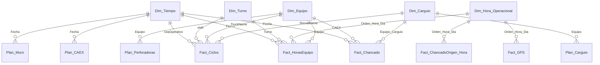

# Arquitectura del modelo

Modelo semántico del informe «Centro de Operaciones Demo» (empresa ficticia Minera Demo): 23 tablas, 122 medidas DAX, 38 relaciones y 4 parámetros.
Todo está en TMDL (`pbip/CentroOperacionesDemo.SemanticModel/definition/`) y el informe en PBIR (`pbip/CentroOperacionesDemo.Report/`).

## Capas

| Capa | Tablas | Para qué sirve |
|---|---|---|
| Dimensiones | `Dim_Equipo`, `Dim_Carguio`, `Dim_Turno`, `Dim_Tiempo`, `Dim_Hora_Operacional` | Filtran todos los hechos. `Dim_Carguio` es una referencia a `Dim_Equipo` (la página la filtra a palas y cargadores con `Es Carguio = 1`) para no cruzar los dos lados de un ciclo. |
| Hechos horarios | `Fact_HorasEquipo`, `Fact_HorasEquipo_Muro`, `Fact_ChancadoOrigen_Hora`, `Fact_LeyAlimentacion_Hora`, `Fact_VelocidadCAEX_Hora` | Una fila por equipo u origen y hora del día operacional. |
| Hechos de detalle | `Fact_Ciclos`, `Fact_Chancado`, `Fact_GPS` | Un ciclo de acarreo, un grupo de descargas a chancado, una lectura GPS de baja velocidad. |
| Planes | `Plan_CAEX`, `Plan_Carguio`, `Plan_Perforadoras`, `Plan_Muro`, `Plan_Semanal_Chancador` | Referencia diaria para el semáforo (real contra plan). |
| Selectores de métrica | `Dim_Metrica_Flota`, `Dim_Metrica_Carguio`, `Dim_Metrica_Perforadoras`, `Dim_Flota_Tipo` | Tablas calculadas de 3 a 6 filas que arman las matrices «Real / Plan» con una sola medida por matriz. |
| Encabezado | `Dim_Actualizacion` | Una fila con la hora del último refresco; la medida `SVG_Ultima_Actualizacion` la dibuja. |

Ninguna tabla tiene dirección de filtro bidireccional: todas las relaciones son de muchos a uno, con filtro de la dimensión hacia el hecho.

## Relaciones

El diagrama muestra el patrón; las 38 relaciones completas están en `relationships.tmdl`. Lo que cambia de un hecho a otro es qué dimensiones usa:
los planes diarios solo cruzan por fecha (y por equipo los de carguío y perforación), los hechos horarios agregan `Dim_Hora_Operacional`, y `Fact_GPS`
y `Fact_VelocidadCAEX_Hora` cruzan además por equipo y turno.

## Día operacional, turno y hora

- **Día operacional**: de 08:00 a 08:00. Las horas 00:00-07:59 pertenecen al día operacional anterior.
- **Turnos**: A de 08:00 a 19:59 y B de 20:00 a 07:59.
- **`Orden_Hora_Dia`** numera las 24 horas del día operacional: 1 a 12 es el turno A (08:00 a 19:00) y 13 a 24 el turno B (20:00 a 07:00). Es la clave que une
  los hechos horarios con `Dim_Hora_Operacional`. Cuando el hecho trae la hora como índice dentro del turno (`Hora` de 0 a 11) o como `HoraTurno` (1 a 12), una
  columna calculada la convierte: `Hora + 1` (turno A) o `Hora + 13` (turno B).
- **`Dim_Hora_Operacional`** además trae filas de relleno que no son horas: la clave 99 (hueco visual entre turnos) y 96 a 98 (tres casillas vacías antes del
  turno A). Los gráficos las usan para separar los turnos en el eje X y alinear las columnas de la tabla de ley; `Es_Espacio = 1` las identifica y las medidas devuelven en blanco.
- Las etiquetas de eje con caracteres invisibles (`UNICHAR(8203)`) hacen únicas las casillas que se muestran vacías.

## Parámetros y datos

| Parámetro | Valor por defecto | Uso |
|---|---|---|
| `RutaDatos` | `..\datos_sinteticos\` | Carpeta de los CSV. Power Query necesita una ruta absoluta: `herramientas/configurar_ruta.py` la fija en tu copia. |
| `FechaReferencia` | 2025-05-31 | Hace de «día operacional en curso». En una instalación real se calcularía con el reloj y cambiaría a las 08:00. |
| `DiasHistoria` | 90 | Ventana de historia del calendario y de las tablas horarias. |
| `DiasHistoriaGPS` | 7 | Ventana de las tablas GPS (`Fact_GPS`, `Fact_VelocidadCAEX_Hora`). |

Cada partición `m` lee un CSV con `Csv.Document(File.Contents(RutaDatos & "archivo.csv"))`, fija los tipos con la cultura `en-US` (los CSV usan punto decimal)
y, en las tablas horarias y de detalle, filtra por la ventana de historia. `Dim_Tiempo` y `Dim_Actualizacion` se generan en Power Query; `Dim_Carguio` referencia a `Dim_Equipo`.

Los CSV horarios traen los últimos 7 días del período (límite de 2 MB por archivo); los planes y el calendario cubren los 90 días. El último día queda a medias
a propósito, para ver un turno en curso con sus proyecciones.

## Equipos de Mina y de Muro

El nombre del equipo lleva la regla: los equipos con sufijo `_M` pertenecen a la flota de Muro y alimentan `Fact_HorasEquipo_Muro`; los demás, a Mina.
`Dim_Equipo[Activo_KPI]` (1 o 0) concentra qué equipos cuentan en los KPI: quedan fuera los de Muro, el CAEX auxiliar `CAEX-90` y los de la flota `Equipo Testeo`.
Las medidas de flota (`Flota Palas Total`, etc.) filtran por `Activo_KPI = 1`. La regla vive en `sql/01_dim_equipo.sql` y en el CSV equivalente.

## Patrones de DAX

- **Una medida por matriz.** Las matrices «Real / Plan» de flota, carguío y perforación ponen en filas el equipo, en columnas la métrica (DF, UEBD,
  Rendimiento) y el tipo (Real, Plan) tomados de las tablas calculadas. La medida `Valor ...` lee `SELECTEDVALUE` de cada selector y hace `SWITCH` hacia
  la medida concreta; `Color Valor ...` hace lo mismo con el color de fuente. Menos medidas en el visual y formato condicional centralizado.
- **Semáforo por medida.** Las medidas `Color_*` devuelven el color en texto (`#00C853` verde si el real alcanza el plan, `#FF5C5C` rojo si no, gris si falta
  el plan) y el visual las usa como «color de fuente por valor de campo». La regla de negocio queda en el modelo, no en cada visual.
- **Plan filtrado por los equipos visibles.** `Plan_Carguio` y `Plan_Perforadoras` usan `TREATAS(VALUES(Fact_HorasEquipo[Equipo]), Plan[Equipo])`, de modo que el
  plan se agrega solo para los equipos que están en pantalla.
- **«Última hora con datos».** `Mostrar Punto GPS` y `Velocidad Promedio CAEX Turno` calculan la última fecha y hora con datos con `CALCULATE` y `REMOVEFILTERS`
  sobre las dimensiones de hora y turno, y muestran eso mientras el usuario no elija otra cosa. En una pantalla 24/7 el operador nunca toca un filtro.
- **Fecha efectiva.** `Fecha_Efectiva` devuelve la fecha del segmentador si hay una sola, o el día operacional en curso. Las medidas de plan la usan para ir a la fila correcta.
- **Proyección a 24 horas.** `Proyeccion Mov Mina` divide lo acumulado por las horas del día con movimiento (`Horas Dia Con Datos`) y multiplica por 24.
- **Texto «Dia actual».** `Dim_Tiempo[Dia_Etiqueta]` rotula el día en curso como «Dia actual»; el segmentador guarda ese texto y la selección se mueve sola al
  día siguiente en cada refresco.

## Convenciones

- Nombres de tabla con prefijo `Dim_`, `Fact_`, `Plan_`; medidas con espacios y sin prefijo, salvo las de color (`Color ...` o `Color_...`).
- Las medidas auxiliares van ocultas (`isHidden`); las columnas técnicas de orden también.
- Los porcentajes se guardan como fracción y se muestran con el formato `0.0 %`; las toneladas se muestran en miles de t (`kt`) solo en las tarjetas, con el formato del visual.
- Sin comentarios históricos en el DAX: los comentarios que quedan explican una decisión de diseño.
