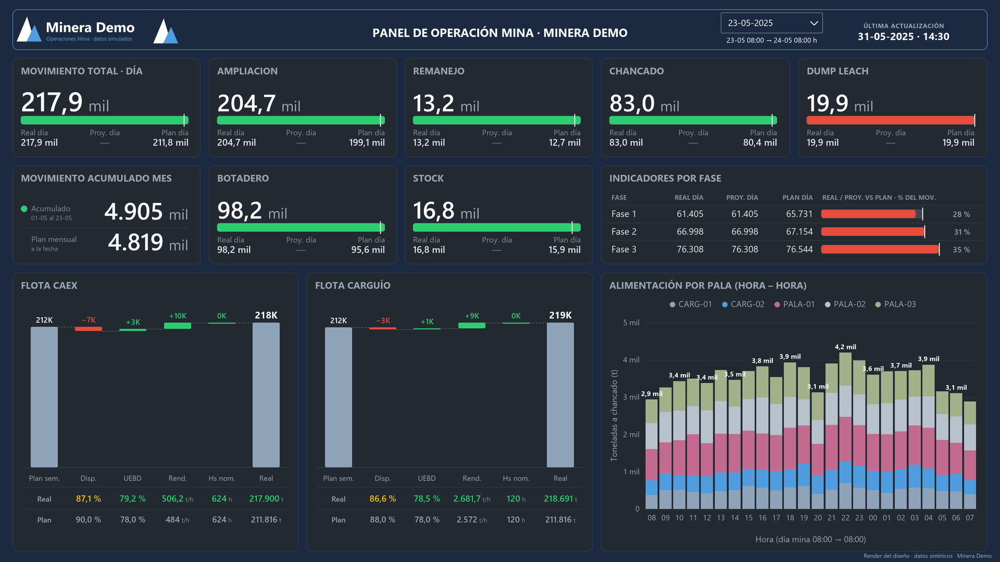
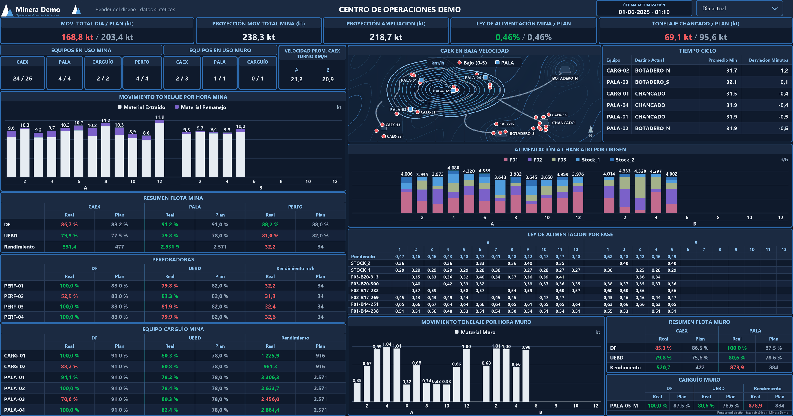
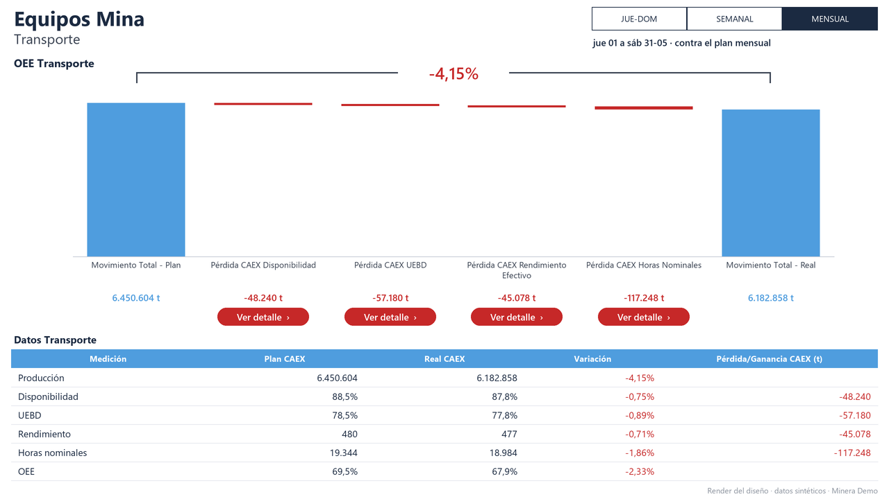
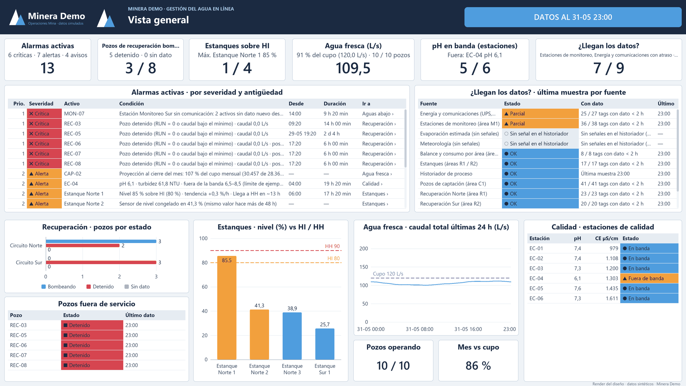
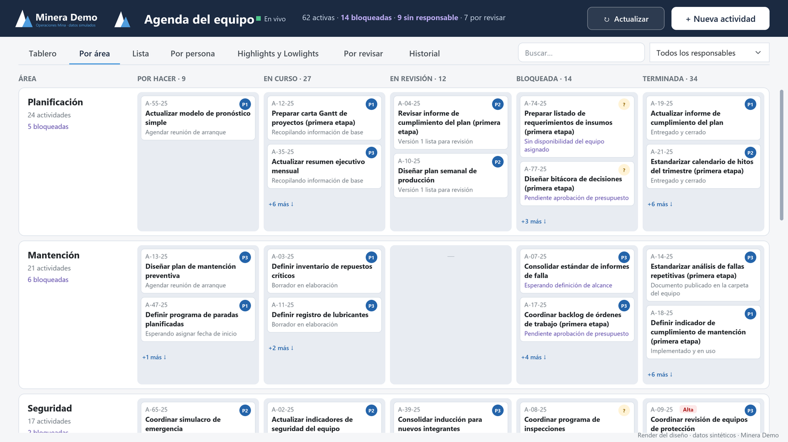
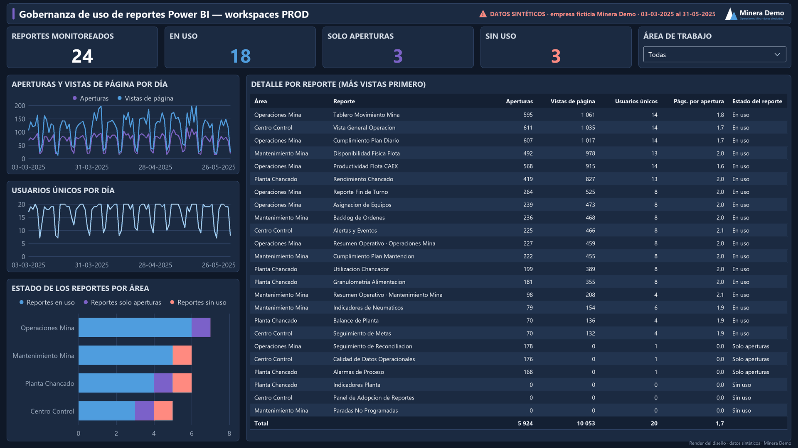
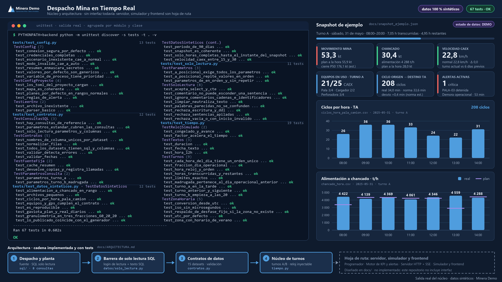
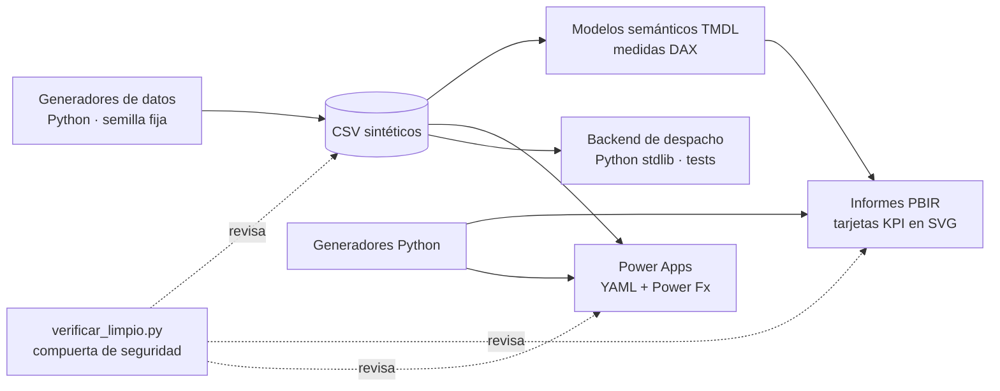

# ⛏️ Minera Demo · Analítica de Operaciones Mina


**Autor:** Alejandro Porcile Henry

Este repositorio muestra **qué construí y cómo trabajo**: informes de Power BI para la operación de una mina a rajo abierto, aplicaciones de Power Apps, automatización
con Python y diseño de arquitectura de datos. Todo ocurre en una mina **ficticia («Minera Demo»)** con datos simulados (miles de t, camiones CAEX a 15–30 km/h, DF y UEBD
en %, chancado en t/h, granulometría en tres fracciones ≈ 60/20/20).

> ### 🔒 Sobre la confidencialidad
> Estos trabajos nacen de desarrollos reales hechos en un entorno minero profesional. **Para proteger a la empresa y a las
> personas, se ocultó o reemplazó toda la información real**: nombre de la empresa y de la faena, logos y colores de marca,
> servidores, bases de datos y sistemas internos, tags de proceso, códigos de equipos, nombres y correos de personas, rutas,
> direcciones web, identificadores, credenciales y cifras de operación. En su lugar hay una empresa **ficticia («Minera Demo»)**,
> logos y paleta inventados y **datos sintéticos** generados por script con semilla fija.
> Lo que se conserva es la parte reutilizable: la arquitectura, el modelamiento DAX/TMDL, los generadores en Python, el diseño
> de las apps y la forma de verificar el trabajo. Ningún dato de este repositorio es real.

> **Sobre las imágenes.** Son **renders del diseño**: las dibujé con las posiciones y los datos sintéticos de cada proyecto para mostrar cómo se ven los informes y las
> apps sin exponer nada real. No son capturas de Power BI Desktop ni de Power Apps Studio, y cada una lo dice al pie.

## De un vistazo

<table>
<tr>
<td width="50%"><a href="01-powerbi-tmdl-gestion-minera"></a><br><b>01 · Informe ejecutivo de operaciones</b><br>Mina y Molienda contra plan, con tarjetas KPI hechas en DAX.</td>
<td width="50%"><a href="07-centro-operaciones-pbip"></a><br><b>07 · Centro de operaciones</b><br>Pantalla de sala de control para TV: flota, chancado, ciclos y mapa.</td>
</tr>
<tr>
<td width="50%"><a href="02-oee-caex-y-app-desempeno"></a><br><b>02 · OEE de transporte (CAEX) y app de desempeño</b><br>Cascada del plan al real que cierra exacto, más la app de la reunión semanal.</td>
<td width="50%"><a href="06-sustentabilidad-agua"></a><br><b>06 · Gestión del agua</b><br>Balance hídrico, alarmas y calidad con 211 señales sintéticas.</td>
</tr>
<tr>
<td width="50%"><a href="05-power-apps-codegen"></a><br><b>05 · Agenda del equipo (Power Apps)</b><br>App de lienzo cuyo código se genera con Python a partir de un contrato de datos.</td>
<td width="50%"><a href="03-governance-bi-as-code"></a><br><b>03 · Gobernanza de reportes (BI como código)</b><br>Qué informes se usan y cuáles no; el informe completo sale de código.</td>
</tr>
<tr>
<td colspan="2"><a href="04-despacho-tiempo-real"></a><br><b>04 · Despacho en tiempo real (núcleo y arquitectura)</b><br>Salida real de los 67 tests, snapshot de ejemplo y arquitectura. Este proyecto aún no tiene interfaz: el servidor y el frontend son hoja de ruta.</td>
</tr>
</table>

## Cómo trabajo

Estas son las costumbres que se repiten en todos los proyectos y que puedes comprobar en el código:

1. **Todo como código.** Los modelos de Power BI están en TMDL, los informes en PBIR y las apps de Power Apps en YAML, y la mayoría se **generan con Python**. Así se
   revisan en un diff, se reproducen y se regeneran en vez de repetir clics.
2. **El contrato de datos va primero.** Defino tablas, columnas, estados y parámetros una sola vez, y de ahí salen la app, los datos de ejemplo y los tests (proyectos 04 y 05).
3. **Verifico antes de mostrar.** Escribo verificadores propios que cruzan modelo, informe y datos; una cascada de pérdidas que suma exactamente el total; 67 tests; 49 chequeos
   DAX con cifras esperadas calculadas por separado.
4. **Datos de ejemplo con intención.** Sintéticos, con semilla fija, rangos creíbles para una mina a rajo abierto y casos de borde sembrados a propósito (equipos detenidos,
   reportes sin uso, un sensor congelado, un área cuya extracción se cortó).
5. **Diseño para quien lo usa.** Una pantalla para sala de control se lee a distancia y no tiene nada que tocar; una app de reunión tiene un editor para preparar y un visor para
   proyectar; el semáforo es lo único que usa verde y rojo.
6. **Seguridad y confidencialidad por diseño.** Reconstruí este repositorio desde cero con datos sintéticos en vez de «limpiar» los originales, y una compuerta automática revisa
   cada cambio ([`tools/verificar_limpio.py`](tools/verificar_limpio.py)).
7. **Digo lo que no probé.** Cada proyecto trae una sección de qué se verificó y qué no, y las decisiones de arquitectura quedan escritas.

## Los proyectos

### 01 · Informe ejecutivo de operaciones (Mina y Molienda)
**Problema:** dar a la dirección una vista única del movimiento de mina y del rendimiento de planta, con semáforos contra el plan.
**Qué construí:** un modelo estrella en TMDL, tarjetas KPI que son medidas DAX que devuelven un SVG, generadores en Python que editan el modelo y el informe por
estructura, y un verificador que cruza modelo, informe y datos.
**Resultado:** 2 páginas y 69 visuales sobre 29 tablas y 124 medidas; el verificador termina en 0 errores.
**Habilidades:** DAX avanzado, TMDL/PBIR, automatización con Python, SQL. → [Ver el proyecto](01-powerbi-tmdl-gestion-minera)

### 02 · OEE de transporte (CAEX) y app de reunión de desempeño
**Problema:** preparar y proyectar la reunión semanal de desempeño de operaciones mina con el OEE de la flota de camiones.
**Qué construí:** una cascada de pérdidas (disponibilidad física → utilización efectiva → rendimiento) que cierra exactamente, y una app de lienzo con un **editor** (se prepara
antes) y un **visor** (se proyecta en sala), generada con Python (YAML + Power Fx).
**Resultado:** 16 tablas, 100 medidas, 5 páginas y 89 visuales, más una app de 3 pantallas; el validador termina en 0 problemas.
**Habilidades:** DAX, Power Apps, Power Fx, generación de código. → [Ver el proyecto](02-oee-caex-y-app-desempeno)

### 03 · Gobernanza de uso de reportes (BI como código)
**Problema:** saber qué informes de los workspaces productivos se usan y cuáles no.
**Qué construí:** un informe completo **generado por script**, con verificadores de disco y de modelo y 49 chequeos DAX; los casos de borde (informes sin uso, solo aperturas,
abandonados, extracción cortada) están sembrados a propósito en los datos.
**Resultado:** 6 páginas y 59 visuales sobre 7 tablas y 22 medidas; los 69 JSON del informe validan contra los esquemas de Power BI Desktop.
**Habilidades:** ingeniería de datos, calidad de datos, reporting como código. → [Ver el proyecto](03-governance-bi-as-code)

### 04 · Despacho en tiempo real (núcleo y arquitectura)
**Problema:** un tablero local para la sala de despacho que se actualiza cada pocos segundos y nunca presenta datos viejos como si fueran actuales.
**Qué construí:** el núcleo en Python con solo biblioteca estándar: turnos A/B y día operacional con reloj inyectable, contratos de 15 datasets, una **barrera SQL de solo
lectura** y 8 consultas parametrizadas; más la arquitectura documentada con decisiones (ADR) y un checklist de ciberseguridad.
**Resultado:** 67 tests que pasan. El servidor, el simulador y el frontend están diseñados pero **no implementados**, y así se dice.
**Habilidades:** diseño de arquitectura, Python, seguridad de datos, SQL. → [Ver el proyecto](04-despacho-tiempo-real)

### 05 · Agenda del equipo (Power Apps con código generado)
**Problema:** seguimiento de actividades del área con un tablero por área × estado, vistas por persona y un espacio para decidir qué se revisa.
**Qué construí:** un contrato de datos en Python del que salen el generador de YAML y los datos de ejemplo; la app se pega en Power Apps Studio capa por capa, con un
verificador estático propio.
**Resultado:** una app de lienzo con 7 vistas, 10 archivos YAML y 402 controles que no se escriben a mano; regenerar produce archivos idénticos.
**Habilidades:** arquitectura Power Platform, Power Fx, generación de código, diseño de interfaces. → [Ver el proyecto](05-power-apps-codegen)

### 06 · Gestión del agua (sustentabilidad)
**Problema:** monitorear casi en tiempo real la captación, el consumo, la recirculación y la calidad del agua de una operación.
**Qué construí:** un modelo con balance hídrico que cierra, un motor de alarmas en DAX (pozo detenido, sensor congelado, tranque subiendo, calidad fuera de banda) y una fuente
intercambiable entre CSV sintético y un historiador de proceso.
**Resultado:** 12 tablas, 338 medidas, 11 páginas y 178 visuales, con 211 señales sintéticas; el verificador valida 199 archivos JSON y 556 referencias a campos.
**Habilidades:** DAX, modelado de series de tiempo, alarmas, diseño de tableros. → [Ver el proyecto](06-sustentabilidad-agua)

### 07 · Centro de operaciones (pantalla de sala de control)
**Problema:** una pantalla para una sala de control, sin filtros, legible a distancia en una TV.
**Qué construí:** un informe de 2740 × 1440 px con fondo oscuro, contrastes medidos y un modelo de 23 tablas con ciclos, GPS y velocidad de CAEX, horas de equipo con DF y UEBD,
chancado por origen y planes; la hora del día es el eje compartido.
**Resultado:** 23 tablas, 122 medidas y 38 relaciones; el verificador termina en 0 errores.
**Habilidades:** modelo dimensional, DAX, diseño para pantallas grandes. → [Ver el proyecto](07-centro-operaciones-pbip)

## Herramientas y habilidades

| Área | Qué uso | Dónde verlo |
|---|---|---|
| **Power BI** | DAX avanzado, modelo en TMDL, informes PBIR, Power Query (M) parametrizado, tarjetas KPI en SVG | 01, 02, 03, 06, 07 |
| **Power Platform** | Power Apps de lienzo (YAML + Power Fx), editor y visor, funcionamiento sin conexión | 02, 05 |
| **Python** | Generadores de código, verificadores, datos sintéticos reproducibles, tests con `unittest` | todos |
| **SQL** | Consultas con CTE, ventanas y agregación por hora; barrera de solo lectura | 04, 01, 07 |
| **Arquitectura y calidad** | Contratos de datos, decisiones documentadas (ADR), integración continua en GitHub Actions | 04, 05, `.github/` |
| **Diseño** | Pantallas de sala de control, semáforos, tarjetas KPI, apps para reuniones | 05, 06, 07 |

## Qué está verificado y qué no

- **Verificado:** coherencia de modelos y visuales con verificadores propios, TMDL y esquemas PBIR validados con las herramientas de Power BI Desktop en los proyectos 01 y 03,
  67 tests en el 04, YAML de las apps parseado y validado, y la compuerta de seguridad en cada cambio del repositorio.
- **No probado:** la apertura y el refresco de los informes en Power BI Desktop con estos datos, el pegado en Power Apps Studio y la ejecución de las consultas SQL contra un
  motor real. Cada proyecto detalla sus límites.

<details>
<summary><b>Para quien quiera revisar el código</b>: estructura, arquitectura general y cómo ejecutar</summary>

### Arquitectura general



### Estructura

```
├─ tools/        sinteticos.py · generar_logo_demo.py · verificar_limpio.py · capturas/ (renders)
├─ assets/       logos ficticios y paleta de Minera Demo
├─ 01 … 07/      un proyecto por carpeta (README, capturas/, datos_sinteticos/, docs/, código)
├─ NOTICE.md  SECURITY.md  LICENSE
└─ .github/workflows/sanitizacion.yml
```

### Cómo usar

1. **Datos:** cada proyecto trae `datos_sinteticos/generar_datos.py` (usa `tools/sinteticos.py`) y los CSV ya generados.
2. **Power BI:** abre el `.pbip` con Power BI Desktop. El parámetro `RutaDatos` trae un valor marcador; apúntalo a la carpeta `datos_sinteticos` del proyecto
   (varios proyectos incluyen `configurar_ruta.py` para hacerlo).
3. **Power Apps:** el YAML se pega en Studio capa por capa (ver `05-power-apps-codegen`).
4. **Backend de despacho:** `cd 04-despacho-tiempo-real` y, con `PYTHONPATH=backend`, `python -m unittest discover -s tests -t .`.
5. **Compuerta de seguridad:** `python tools/verificar_limpio.py`.
6. **Renders de las imágenes:** `python tools/capturas/cap_01.py` (y `cap_02.py` … `cap_07.py`) regeneran los PNG de cada proyecto.

</details>

## Seguridad y licencia

Sin credenciales, logos, nombres, servidores, correos ni datos de operación reales. Ver [SECURITY.md](SECURITY.md) y [NOTICE.md](NOTICE.md). Licencia [MIT](LICENSE).
