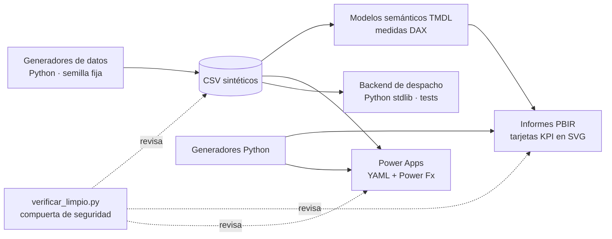

# ⛏️ Minera Demo · Analítica de Operaciones Mina


Portafolio de **modelamiento DAX/TMDL**, **automatización con Python**, **arquitectura Power Platform** e
**ingeniería de datos** aplicados a una mina de cobre a rajo abierto **ficticia** («Minera Demo»).
Todos los datos son simulados (miles de t, camiones CAEX a 15–30 km/h, DF y UEBD en %, chancado en t/h,
granulometría en tres fracciones ≈ 60/20/20) y se regeneran con un script y semilla fija.

**Autor:** Alejandro Porcile Henry

> ### 🔒 Sobre la confidencialidad
> Estos trabajos nacen de desarrollos reales hechos en un entorno minero profesional. **Para proteger a la empresa y a las
> personas, se ocultó o reemplazó toda la información real**: nombre de la empresa y de la faena, logos y colores de marca,
> servidores, bases de datos y sistemas internos, tags de proceso, códigos de equipos, nombres y correos de personas, rutas,
> direcciones web, identificadores, credenciales y cifras de operación. En su lugar hay una empresa **ficticia («Minera Demo»)**,
> logos y paleta inventados y **datos sintéticos** generados por script con semilla fija.
> Lo que se conserva es la parte reutilizable: la arquitectura, el modelamiento DAX/TMDL, los generadores en Python, el diseño
> de las apps y la forma de verificar el trabajo. Ningún dato de este repositorio es real.

## Arquitectura



## Proyectos

| # | Proyecto | Qué muestra | Tamaño |
|---|---|---|---|
| [01](01-powerbi-tmdl-gestion-minera) | **Informe ejecutivo de operaciones** (Mina y Molienda) | Modelo estrella en TMDL, tarjetas KPI SVG como medidas DAX, generadores Python del informe, SQL sobre un esquema ficticio | 29 tablas · 124 medidas · 2 páginas · 69 visuales |
| [02](02-oee-caex-y-app-desempeno) | **OEE de transporte (CAEX) + app de gestión de desempeño** | Cascada DF → UEBD → rendimiento en DAX, app Power Apps Editor/Visor generada con Python (YAML + Power Fx) | 16 tablas · 100 medidas · 5 páginas · 89 visuales · 3 pantallas |
| [03](03-governance-bi-as-code) | **Gobernanza de uso de reportes (BI como código)** | Informe 100 % generado por script, verificadores de disco y de modelo, 49 chequeos DAX | 7 tablas · 22 medidas · 6 páginas |
| [04](04-despacho-tiempo-real) | **Despacho mina en tiempo real (núcleo y arquitectura)** | Backend en biblioteca estándar de Python: turnos, reloj inyectable, barrera SQL de solo lectura, contratos de datos, 8 consultas | 67 tests · 15 datasets |
| [05](05-power-apps-codegen) | **Agenda del equipo (Power Apps contract-first)** | Generar el YAML con Python a partir de un contrato de datos y pegarlo en Studio | 10 YAML · 402 controles |
| [06](06-sustentabilidad-agua) | **Gestión del agua (sustentabilidad)** | Balance hídrico, alarmas y calidad con 211 señales sintéticas, modo CSV/historiador | 12 tablas · 338 medidas · 11 páginas · 178 visuales |
| [07](07-centro-operaciones-pbip) | **Centro de operaciones (pantalla de sala de control)** | Informe de 2740×1440 px para TV, mapa, ciclos, GPS, chancado y planes | 23 tablas · 122 medidas · 38 relaciones |

## Cada trabajo en detalle

### 01 · Informe ejecutivo de operaciones (Mina y Molienda)
- **Problema:** dar a la dirección una vista única de movimiento de mina y rendimiento de planta, con semáforos contra el plan.
- **Qué construí:** modelo estrella en TMDL (29 tablas, 124 medidas), tarjetas KPI que son medidas DAX que devuelven SVG,
  generadores Python que editan TMDL y PBIR por estructura, consultas SQL sobre un esquema ficticio y un verificador propio
  que cruza modelo, informe y datos.
- **Habilidades:** DAX avanzado, TMDL/PBIR, automatización con Python, SQL, validación estática.

### 02 · OEE de transporte (CAEX) y app de reunión de desempeño
- **Problema:** preparar y proyectar la reunión semanal de desempeño de operaciones mina con el OEE de la flota de camiones.
- **Qué construí:** modelo de 16 tablas y 100 medidas con periodos relativos y una cascada de pérdidas
  (disponibilidad física → utilización efectiva → rendimiento) que cierra exactamente; app de lienzo de Power Apps con un
  **editor** (se prepara antes) y un **visor** (se proyecta en sala), generada con Python (YAML + Power Fx), y datos de ejemplo
  de sus 9 tablas.
- **Habilidades:** DAX, Power Apps, Power Fx, generación de código, modelo de datos Excel/SharePoint.

### 03 · Gobernanza de uso de reportes (BI como código)
- **Problema:** saber qué informes de los workspaces productivos se usan y cuáles no.
- **Qué construí:** informe completo (7 tablas, 22 medidas, 6 páginas) **generado por script**, con verificadores de disco y de
  modelo y 49 chequeos DAX; casos de borde sembrados en los datos (informes sin uso, solo aperturas, abandonados, extracción cortada).
- **Habilidades:** ingeniería de datos, calidad de datos, reporting como código, PowerShell y Python.

### 04 · Despacho mina en tiempo real (núcleo y arquitectura)
- **Problema:** un tablero local para sala de despacho que se actualiza cada pocos segundos y nunca presenta datos viejos como reales.
- **Qué construí:** el núcleo en Python con solo biblioteca estándar: turnos A/B y día operacional con reloj inyectable,
  contratos de 15 datasets, una **barrera SQL de solo lectura** y 8 consultas parametrizadas, con 67 tests; documentación de
  arquitectura con decisiones (ADR) y checklist de ciberseguridad.
- **Estado:** el motor de KPI, las alertas, el servidor con SSE, el simulador y el frontend son hoja de ruta y no están implementados.

### 05 · Agenda del equipo (Power Apps contract-first)
- **Problema:** seguimiento de actividades del área con tablero por área × estado, vistas por persona y revisión.
- **Qué construí:** un contrato de datos en Python del que salen el generador de YAML (10 pantallas, 402 controles) y los datos
  de ejemplo; el YAML se pega en Power Apps Studio capa por capa, con un verificador estático propio.
- **Habilidades:** arquitectura Power Platform, generación de código, diseño de interfaces.

### 06 · Gestión del agua (sustentabilidad)
- **Problema:** monitorear en tiempo casi real captación, consumo, recirculación y calidad del agua de una operación.
- **Qué construí:** modelo de 12 tablas y 338 medidas, informe de 11 páginas y 178 visuales con balance hídrico, alarmas
  (pozos detenidos, sensor congelado, tranque subiendo, calidad fuera de banda) y un modo de fuente que alterna entre CSV
  sintético y un historiador de proceso; 211 señales ficticias y un mockup de sinóptico.
- **Habilidades:** DAX, modelado de series de tiempo, alarmas, diseño de dashboards.

### 07 · Centro de operaciones (pantalla de sala de control)
- **Problema:** una pantalla de 1920×1080 para sala de control, sin filtros, legible a distancia.
- **Qué construí:** informe de 2740×1440 px con fondo oscuro, 23 tablas y 122 medidas (ciclos, GPS y velocidad de CAEX,
  horas de equipo con DF y UEBD, chancado por origen y planes), mapa y criterios de diseño con contrastes calculados.
- **Habilidades:** modelo dimensional, DAX, diseño para pantallas grandes.

> En todos los proyectos la verificación fue **estática** (verificadores propios, TMDL y esquemas PBIR, tests unitarios):
> no se abrió el trabajo en Power BI Desktop ni en Power Apps Studio. Cada README de proyecto detalla sus límites.

## Estructura

```
├─ tools/        sinteticos.py · generar_logo_demo.py · verificar_limpio.py
├─ assets/       logos ficticios y paleta de Minera Demo
├─ 01 … 07/      un proyecto por carpeta (README, datos_sinteticos/, docs/, código)
├─ NOTICE.md  SECURITY.md  LICENSE
└─ .github/workflows/sanitizacion.yml
```

## Cómo usar

1. **Datos:** cada proyecto trae `datos_sinteticos/generar_datos.py` (usa `tools/sinteticos.py`) y los CSV ya generados.
2. **Power BI:** abre el `.pbip` con Power BI Desktop. El parámetro `RutaDatos` trae un valor marcador; apúntalo a la
   carpeta `datos_sinteticos` del proyecto (varios proyectos incluyen `configurar_ruta.py` para hacerlo).
3. **Power Apps:** el YAML se pega en Studio capa por capa (ver `05-power-apps-codegen`).
4. **Backend de despacho:** `cd 04-despacho-tiempo-real` y, con `PYTHONPATH=backend`,
   `python -m unittest discover -s tests -t .`.
5. **Compuerta de seguridad:** `python tools/verificar_limpio.py`.

## Qué está verificado y qué no

- **Verificado:** coherencia de modelos y visuales con verificadores propios, TMDL y esquemas PBIR validados con las
  herramientas de Power BI Desktop en los proyectos 01 y 03, 67 tests en el 04, YAML parseado en 02 y 05.
- **No probado:** la apertura y el refresco en Power BI Desktop, el pegado en Power Apps Studio y la ejecución de las
  consultas SQL contra un motor real. Cada README de proyecto detalla sus límites.

## Seguridad

Sin credenciales, logos, nombres, servidores, correos ni datos de operación reales. Ver [SECURITY.md](SECURITY.md) y
[NOTICE.md](NOTICE.md). Licencia [MIT](LICENSE).
